# Journal de projet — MATH60629 (apprentissage automatique)

Ce document suit le projet **étape par étape**. Il sert de base pour rédiger le rapport final en équipe.
Chaque étape indique son objectif, la question ML à laquelle elle répond, ce que dit la littérature, les
expériences, les métriques, les figures à produire et, une fois faite, les résultats.

- **Remise du rapport :** 15 décembre 2026, sur ZoneCours. Maximum 13 pages + références (équipe de 3).
- **Ordre de travail :** Anis fait le code, les 3 blocs ML et la littérature, puis présente les résultats à
  Ulrich et Rami. **Le rapport final est rédigé en équipe ensuite.** Ce journal ne le remplace pas.
- **Références :** les citations entre parenthèses (auteur, année) renvoient à la bibliographie de la
  section 11. Toutes y sont marquées comme vérifiées.

> **Légende des statuts :** ☐ à faire · ◐ en cours · ☑ terminé

---

## 1. Question de recherche (validée par le professeur)

> Des modèles d'apprentissage automatique, combinés à une prévision de volatilité et à un filtre de
> classification, peuvent-ils produire un signal ajusté au risque assez fiable pour bâtir une stratégie
> long/short hebdomadaire rentable sur cinq grandes devises ?

**Élément de nouveauté (plan d'étude) :**
- des méthodes existantes (régressions pénalisées, forêt aléatoire, GARCH, régression logistique)
- appliquées à un ensemble de données que nous construisons (15 variables, 5 paires, 2004–2026) ;
- l'originalité tient à leur **combinaison** : un modèle choisi pour chaque devise (MIXT), un **Sharpe
  prévu** comme signal, et un **méta-classifieur** qui filtre chaque jambe du trade.

**Comment on y répond : une étude d'ablation.** La question contient trois blocs ML. On évalue chacun
séparément, avec des métriques ML, puis on mesure ce qu'il ajoute en le retirant ou en le remplaçant.
La finance sert seulement d'**évaluation finale** et reste brève dans le rapport, comme demandé par le
professeur.

| Bloc | Tâche ML | Question de l'étape |
|---|---|---|
| 1 | Régression : rendement de la semaine suivante | Les modèles prévoient-ils mieux qu'une référence simple ? Choisir un modèle (MIXT) vaut-il mieux que les combiner ? |
| 2 | Régression : volatilité de la semaine suivante | Le modèle appris (GARCH, HAR) prévoit-il mieux que des références naïves ? Diviser par la volatilité améliore-t-il le classement ? |
| 3 | Classification binaire : la jambe gagne-t-elle ? | Le méta-classifieur sépare-t-il vraiment les bonnes jambes des mauvaises, mieux que le hasard et qu'une règle simple ? |

---

## 2. Critères de notation et comment le projet les vise

Le barème et les conseils viennent de la page officielle du projet. Le tableau indique, pour chaque
critère, ce qui est mis en place pour obtenir tous les points.

| Critère (points) | Ce que le correcteur attend | Ce que nous faisons |
|---|---|---|
| **Clarté et pertinence du problème, description de l'approche (10)** | Une question claire, une méthode décrite précisément, un élément de nouveauté | Question validée ; étude d'ablation en 3 blocs ML ; chaque modèle décrit par son équation, avec tous les symboles définis (sections 3 et 7) |
| **Littérature pertinente et références (5)** | Une section de travaux reliés, avec des références appropriées | Revue organisée en axes ML (section 9) ; chaque choix important appuyé par une source (sections 3 et 7) ; contribution positionnée par rapport aux travaux existants ; résultats comparés à la littérature ; références toutes vérifiées (section 11) |
| **Conception et exécution de l'étude expérimentale (10)** | Des expériences bien conçues, des comparaisons équitables, de la robustesse | Protocole gelé (section 6) ; choix sur la validation seulement ; test évalué une fois ; placebos et tests de permutation ; correction pour tests multiples ; analyses de sensibilité |
| **Présentation : figures, tableaux, rédaction (5)** | Clair, concis, complet ; axes étiquetés ; symboles définis | Figures en PDF vectoriel avec axes, unités et légendes ; liste de contrôle (section 12) |

**Les pièges que la consigne nomme explicitement, et notre parade :**

| Piège cité dans la consigne | Parade |
|---|---|
| Tester sur les données d'entraînement | Walk-forward strict, vérifié dans le code (section 6) |
| Régler des paramètres en trichant | Tous les réglages sur la validation ; seuil τ fixé *a priori* |
| Comparer injustement | Même découpage, mêmes variables et même fréquence de ré-estimation pour tous ; la forêt est réglée comme les modèles pénalisés |
| Axes non étiquetés, symboles non définis | Liste de contrôle (section 12) |
| Ne pas vérifier la robustesse | Sous-périodes, sensibilité aux choix *a priori*, placebo |
| Passer son temps sur le prétraitement | Les données de l'ancien projet sont réutilisées telles quelles ; tout le temps va au ML |

**Pour les 5 points de littérature en particulier**, le rapport doit faire cinq choses :
1. une section de travaux reliés qui **synthétise** des courants de recherche, plutôt qu'une liste
   d'articles ;
2. une **justification par la littérature** de chaque choix méthodologique important ;
3. un **positionnement** clair de notre contribution par rapport à ce qui existe ;
4. une **discussion des résultats à la lumière de la littérature** : ce qui confirme, ce qui contredit ;
5. des **références exactes et vérifiées**, dans un style uniforme, y compris les manuels du cours.

---

## 3. Choix méthodologiques de départ

Avant de lancer les nouvelles expériences, nous avons fixé les choix qui encadrent tout le reste de
l'étude. Ils sont décrits ici pour qu'un lecteur puisse refaire exactement le même chemin et juger la
démarche en connaissance de cause.

**Choisir λ sans mélanger les semaines.** Le Lasso, la Ridge et l'Elastic net choisissent leur pénalité
λ par validation croisée à 5 plis, à l'intérieur des données d'entraînement de chaque semaine. Dans la
version héritée de l'ancien projet, ces plis sont tirés au hasard. Il n'y a pas de fuite vers la semaine
prévue, puisque tout se passe dans le passé. En revanche, des semaines voisines se retrouvent des deux
côtés de la validation. Or elles se ressemblent beaucoup, puisque plusieurs variables sont calculées sur
des fenêtres de 12 à 26 semaines. L'erreur estimée risque donc d'être trop optimiste.

La littérature ne tranche pas complètement :
- la validation croisée classique suppose des observations indépendantes (Arlot et Celisse, 2010 ;
  ESL §7.10) ;
- pour les données dépendantes, on recommande des plis par blocs, avec une zone tampon entre
  l'entraînement et la validation (Racine, 2000 ; Bergmeir et Benítez, 2012) ;
- mais Bergmeir, Hyndman et Koo (2018) montrent que la validation croisée classique reste valide pour
  des modèles autorégressifs dont les erreurs ne sont pas corrélées ;
- et Cerqueira, Torgo et Mozetič (2020) trouvent que, pour les séries non stationnaires, les méthodes
  qui respectent l'ordre du temps estiment mieux l'erreur.

Plutôt que de corriger sans preuve, nous comparons donc la version actuelle à une validation croisée
temporelle : plis par blocs de semaines consécutives, et *forward-chaining*, où l'on entraîne toujours
sur le passé pour valider sur la suite. La version conservée pour la suite est celle qui fait le mieux sur
l'échantillon de validation.

**Régler la forêt aléatoire comme les autres modèles.** La forêt utilisait des réglages par défaut,
alors que les modèles pénalisés voient leur λ ajusté. Probst, Wright et Boulesteix (2019) montrent que les
réglages par défaut donnent en général des résultats raisonnables, mais que le réglage peut encore les
améliorer. Pour que la
comparaison soit équitable, nous réglons une petite grille d'hyperparamètres sur la validation
uniquement : la taille minimale des feuilles et le nombre de variables candidates à chaque division.

**Comparer la sélection d'un modèle à leur combinaison.** MIXT retient, pour chaque devise, le modèle
qui a le meilleur R² en validation. Mais les écarts de R² entre modèles sont minimes, et l'ancien projet
montrait déjà que le classement des modèles se maintient mal d'une période à l'autre (corrélation de
rang de 0,28 entre validation et test). Deux résultats de la littérature vont dans ce sens :
- choisir le meilleur parmi plusieurs modèles proches sur un échantillon fini sur-ajuste la sélection
  elle-même (Cawley et Talbot, 2010) ;
- depuis Bates et Granger (1969), on sait qu'une moyenne simple de prévisions est très difficile à
  battre ; c'est le « *forecast combination puzzle* » (Smith et Wallis, 2009), que Claeskens et al.
  (2016) expliquent par l'erreur d'estimation des poids.

Nous ajoutons donc deux concurrents à MIXT, tous deux classiques en ML (Wolpert, 1992 ; Breiman, 1996 ;
ESL §8.8) :
- la moyenne simple des modèles ;
- un *stacking* contraint, dont les poids sont positifs, somment à 1 et sont estimés sur la validation.

**Ajouter un vrai modèle appris pour la volatilité.** Le GARCH(1,1) n'était comparé qu'à des références
naïves. Nous ajoutons le modèle HAR (Corsi, 2009), qui est la référence standard en prévision de
volatilité réalisée. C'est une régression linéaire de la volatilité réalisée sur ses moyennes passées à
1, 4 et 12 semaines. Le choix est d'autant plus intéressant que, pour les taux de change, Hansen et Lunde
(2005) ne trouvent aucun modèle qui batte clairement le GARCH(1,1). Le modèle de volatilité utilisé dans
le signal est choisi sur la validation.

**Le LSTM comme complément, pas comme cœur de l'étude.** Un LSTM à cinq sorties, qui prévoit d'un coup
les rendements des cinq paires, sera testé dans le bloc des rendements. Il ne sera ajouté qu'une fois
les trois blocs et l'ablation terminés. Il permet d'explorer un modèle séquentiel (Hochreiter et
Schmidhuber, 1997) qui partage l'information entre devises, à la manière de l'apprentissage multitâche
(Caruana, 1997). Vu le très faible rapport signal/bruit des rendements de change, nous n'en attendons pas
de gain particulier : les réseaux récurrents ne sont pas une solution universelle en prévision
(Hewamalage, Bergmeir et Bandara, 2021), et les méthodes simples restent souvent meilleures
(Makridakis, Spiliotis et Assimakopoulos, 2018). Il ne change pas la question étudiée.

**Organisation du travail.** Anis réalise le code, les trois blocs ML et la revue de littérature, puis
présente l'ensemble à Ulrich et Rami. Le rapport final est rédigé en équipe, une fois les résultats
validés par tous.

**Un environnement reproductible.** Toutes les expériences tournent sous Python 3.12, dans un
environnement virtuel créé avec `uv` (`.venv/`, ignoré par git). La version 3.14 installée sur la
machine n'avait pas les bibliothèques nécessaires, et la compatibilité de numba avec cette version
n'était pas assurée. Les versions exactes des paquets sont figées dans `requirements-lock.txt`, dans
l'esprit de la liste de contrôle de reproductibilité de NeurIPS (Pineau et al., 2021).

**Un jeu de données figé.** Les fichiers de `Data/` présents dans le dépôt (commit 8d2bca0) constituent le
jeu de données de référence de l'étude, et `run_data.py` n'est plus relancé. En effet, recalculer les
variables avec des versions plus récentes de numpy et pandas introduit des écarts d'arrondi de l'ordre de
$10^{-14}$, qui suffisent à modifier certaines divisions de la forêt aléatoire (étape 0). Figer les
données garantit que toutes les variantes partent exactement de la même base que les résultats déjà
publiés dans l'ancien projet.

**Des expériences rangées à part.** Les résultats publiés de l'ancien projet (`outputs/` et
`Data/Models/`) ne sont jamais réécrits. Chaque expérience du registre (section 8) a son propre script
dans `Code/experiments/` et son propre dossier de résultats dans `experiments/<ID>/` : tableaux, figures,
et une fiche `environment.json` qui note la machine, les versions des paquets et les temps de calcul. Les
fichiers de modèles (`.pkl`) ne sont pas versionnés, puisqu'ils se régénèrent en relançant le script ;
seuls le code, les tableaux et les figures le sont, ce qui garde le dépôt léger pour l'équipe.

---

## 4. Pipeline du projet

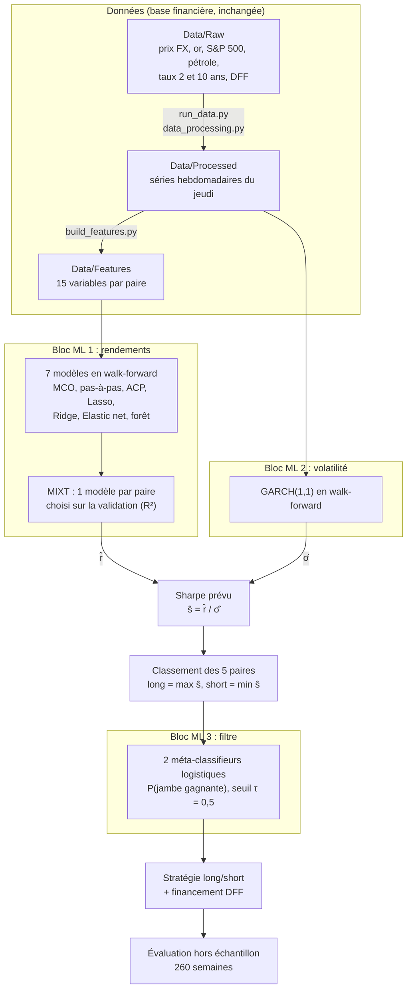

**Correspondance avec le code :**

| Étape du pipeline | Script | Fonctions principales | Sorties |
|---|---|---|---|
| Données → séries hebdomadaires | `run_data.py` → `Code/data_processing.py` | `to_thursday` (`Function/functions.py`) | `Data/Processed/*.csv` |
| Variables | `Code/build_features.py` | `Function/functions_feature.py` | `Data/Features/*_features.csv` |
| Bloc 1 + bloc 2 | `run_strategy.py` → `Code/build_model.py` | `build_walk_forward_models`, `cv_glmnet`, `build_walk_forward_garch_models` | `Data/Models/models.pkl` |
| Bloc 3 + stratégie | `Code/backtest.py` | `meta_expanding_filtered_returns`, `strategy_returns` | `outputs/*.csv`, `outputs/*.png` |
| Analyses ML existantes | `Code/ml_analysis.py` | R² hors échantillon, Clark-West, corrélation de rang, AUC, calibration | `outputs/ml/*.csv` (+ `latex/`, absent localement) |
| Figures du journal | `docs/figures/make_journal_figures.py` | — | `docs/figures/*.png` + `*.pdf` |
| Paquet pour l'équipe | `Code/experiments/e7_paquet_equipe.py` | — | `docs/paquet_equipe/` |
| Nouvelles expériences | `Code/experiments/<id>_*.py` | une par ligne du registre (section 8) | `experiments/<ID>/` (modèles `.pkl` non versionnés) |

---

## 5. Données et découpage

| Élément | Valeur |
|---|---|
| Univers | EUR, GBP, CAD, CHF, JPY contre USD |
| Fréquence | hebdomadaire (jeudi) |
| Semaines utilisables | 1 143 (2004-09-16 → 2026-08-27) |
| Entraînement initial | 529 semaines (2004-09-16 → 2014-11-20) |
| Validation | 354 semaines (2014-11-27 → 2021-09-02) |
| Test | 260 semaines (2021-09-09 → 2026-08-27) |
| Variables | 15 par paire : 6 de taux, 3 macro, 3 de momentum, 1 de retour à la moyenne, 2 de volatilité |
| Cible bloc 1 | rendement logarithmique de la semaine suivante |
| Cible bloc 2 | volatilité réalisée de la semaine suivante (à partir des rendements quotidiens) |
| Cible bloc 3 | 1 si la jambe (long ou short) est gagnante, 0 sinon |

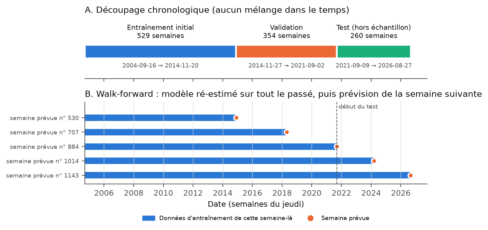

*Figure 1. A : les trois périodes, sans mélange dans le temps. B : à chaque semaine prévue, le modèle
est ré-estimé sur toutes les semaines précédentes (fenêtre croissante), puis prévoit la semaine suivante.*

**Appui dans la littérature.** L'évaluation « à origine glissante », où l'on ré-estime le modèle à chaque
date et prévoit la période suivante, est la méthode de référence pour évaluer une prévision hors
échantillon (Tashman, 2000). Le découpage en trois ensembles, entraînement, validation et test, est celui
du cours (diapos *ml-fundamentals*, p. 63–67 ; Goodfellow et al., 2016, §5.3).

---

## 6. Protocole d'évaluation (gelé avant toute nouvelle expérience)

**Les trois règles du projet :**
1. Tous les choix (variante, hyperparamètre, seuil, poids) se font **sur la validation seulement**.
2. Chaque variante est évaluée **une seule fois** sur le test. On ne revient pas la modifier après avoir vu
   le test.
3. **On rapporte tous les résultats**, même mauvais.

**Pourquoi ces règles.** Elles répondent à deux risques bien documentés :
- **la fuite d'information**, c'est-à-dire l'usage, pendant l'apprentissage, d'une information qui ne
  serait pas disponible au moment de prévoir. Kaufman et al. (2012) recommandent de séparer
  strictement les données d'apprentissage des données de prévision ;
- **le biais de sélection** : un test regardé plusieurs fois devient une validation, et la performance
  annoncée devient trop optimiste (Cawley et Talbot, 2010 ; ESL §7.10.2, « *the wrong and right way to
  do cross-validation* »). En finance, ce même problème porte le nom de sur-ajustement du backtest
  (Bailey et López de Prado, 2014).

**Les trois niveaux de données.** Chaque niveau sert à une seule chose, et le niveau du dessous ne voit
jamais celui du dessus :

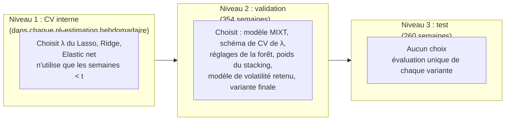

**Pas de regard vers le futur (vérifié dans le code) :**
- **Bloc 1 :** la prévision de la semaine *t* est estimée sur les lignes `X[:t]`, `y[:t]` seulement
  (`build_walk_forward_model`).
- **Bloc 2 :** le GARCH n'utilise que les rendements strictement antérieurs à la date prévue.
- **Bloc 3 :** le méta-classifieur n'est entraîné que sur les jambes dont le résultat est connu à la date
  de décision (`legs["Date"] < date_t`).
- **Seuil τ :** il est fixé *a priori* à 0,5, sans optimisation.

**Points d'attention, à discuter dans le rapport :**
- **(P1) CV interne de λ.** Les plis sont tirés au hasard *à l'intérieur du passé*. Ce n'est pas une fuite
  vers le test. Mais des semaines voisines, très corrélées (la volatilité sur 12 semaines, le MACD sur
  26 semaines), se retrouvent à la fois dans l'entraînement et la validation internes. L'erreur de CV peut
  donc être trop optimiste et pousser à choisir un λ trop petit. C'est pourquoi on compare deux schémas
  de CV (section 3).
- **(P2) Base d'entraînement du méta-classifieur.** Il est entraîné sur les jambes de validation, qui
  viennent d'un MIXT choisi sur ces mêmes semaines. Ces jambes sont donc légèrement optimistes : c'est le
  biais de sélection décrit par Cawley et Talbot (2010).
- **(P3) Stratégie « corrigée ».** La règle « ne rien faire si tous les Sharpe prévus sont positifs »
  (`run_comparison.py`) a été ajoutée après coup. Il faut vérifier si elle a été décidée après avoir vu
  le test. Si oui, il faut la présenter comme une analyse *post hoc*.

**Registre des résultats de test déjà vus (ancien projet, MATH60610A) :** les tableaux de `outputs/` et
`outputs/ml/` ont déjà été regardés. Ils sont **la référence**. Toute nouvelle variante est ajoutée au
registre des expériences (section 8) avant d'être évaluée sur le test.

---

## 7. Plan de travail par étapes

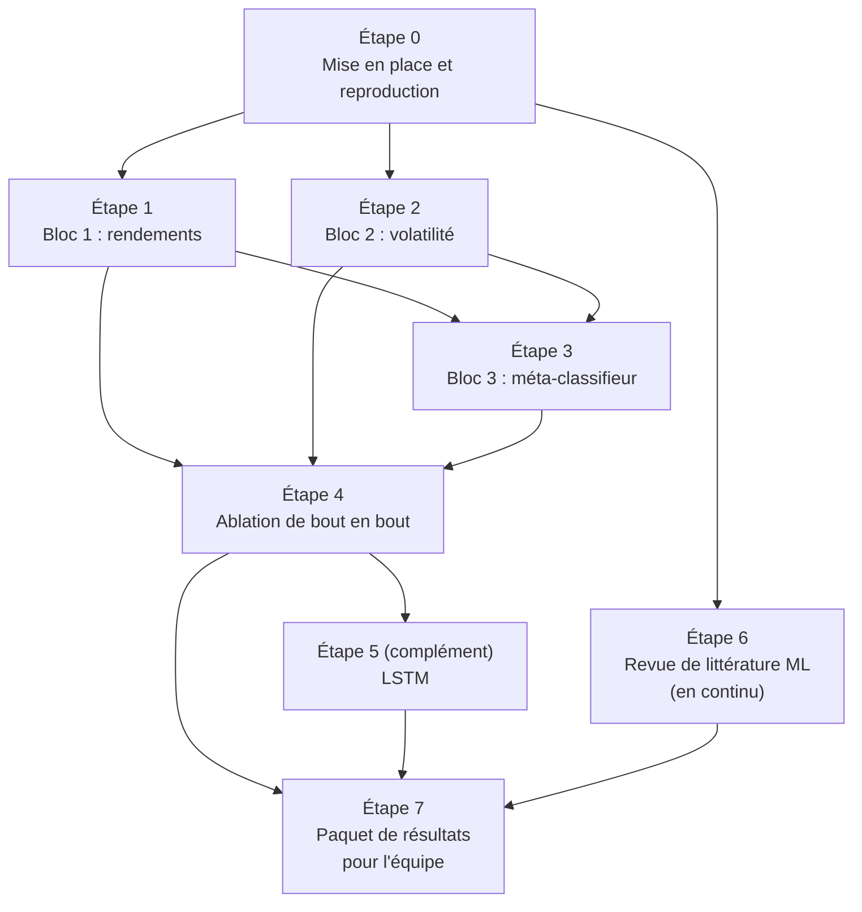

L'étape 3 dépend des étapes 1 et 2 : le méta-classifieur filtre les jambes produites par le signal final
(rendement prévu / volatilité prévue).

### Étape 0 — Mise en place et reproduction ◐ (reste : point P3)
- ☑ Environnement Python 3.12 (`uv venv --python 3.12 .venv` puis
  `uv pip install -r requirements.txt`). Versions installées : numpy 2.5.5, pandas 3.1.1,
  scikit-learn 1.9.1, numba 0.68.1.
- ☑ Relancer `run_data.py`, `run_strategy.py`, `run_comparison.py`, `Code/mixt_features.py` et
  `Code/ml_analysis.py`, puis comparer **chaque** CSV avec la version du dernier commit (8d2bca0).
- ☑ Figer la façon de reproduire les résultats : `Data/` et `outputs/` remis à l'état du commit,
  versions des paquets figées dans `requirements-lock.txt`, `run_data.py` n'est plus relancé.
- ◐ Vérifier le point P3 (origine de la stratégie « corrigée »). L'historique git ne remonte qu'à la
  migration vers Python (4 novembre 2026) : il ne permet pas de dire quand la règle a été décidée. À
  demander à Ulrich.
- ☑ Créer le registre des expériences (section 8) et y inscrire la référence.

**Pourquoi cette étape.** Reproduire d'abord les résultats existants garantit que les écarts mesurés
ensuite viennent bien des changements de méthode, et non de l'environnement. C'est le premier point de la
liste de contrôle de reproductibilité en ML (Pineau et al., 2021).

**Figures :** Figure 1 (☑).

**Résultats.**
- **Temps de calcul** (10 cœurs) : `run_strategy.py` 8 min ; les autres scripts moins d'une minute chacun.
- **Données brutes et prix :** identiques.
- **Variables et rendements recalculés :** écarts de l'ordre de $10^{-14}$, c'est-à-dire de l'arrondi en
  virgule flottante. Ils viennent des versions plus récentes de numpy et pandas.
- **Stratégie finale, méta-classifieur, GARCH et tous les modèles sauf la forêt :** identiques, à
  $10^{-8}$ près au plus. Le choix de MIXT est inchangé, et le Sharpe de la stratégie complète reste
  0,8765.
- **Forêt aléatoire : seul modèle qui change.** Ses prévisions bougent légèrement, et le Sharpe de la
  stratégie qui l'utilise passe de −0,362 à −0,324. Elle n'est jamais choisie par MIXT, donc la
  stratégie n'est pas touchée.
- **Cause, vérifiée :** avec les fichiers de variables du commit, la version actuelle de scikit-learn
  redonne *exactement* les prévisions d'origine (écart nul). Ce sont donc les écarts de $10^{-14}$ dans
  les variables qui suffisent à changer certaines divisions des arbres.
- **Ce que ça montre, à garder pour le rapport :** la forêt est instable face à des perturbations
  infimes des données, ce qui illustre sa variance élevée quand le signal est faible. C'est un argument
  de plus pour la régler (section 3) et pour rapporter la variabilité de ses résultats (Bouthillier et
  al., 2021).
- **Décision :** les données du commit sont conservées comme jeu de référence figé, et les versions des
  paquets sont figées (section 3).
- **Vérification sur les données figées** (modèles réestimés sans relancer `run_data.py`) :
  - **stratégie, backtest, méta-classifieur, sélection MIXT et Sharpe de toutes les stratégies :**
    identiques au commit ;
  - **7 modèles sur 8 :** prévisions de rendement identiques ; les Sharpe prévus diffèrent d'au plus
    $10^{-7}$, à cause de l'optimiseur du GARCH ;
  - **forêt aléatoire, CAD et CHF seulement :** environ 8 % des semaines de validation diffèrent (écart
    ≤ $10^{-4}$), et quelques semaines de test (écart ≤ $7\times10^{-3}$). EUR, GBP et JPY sont identiques ;
  - **cause probable :** l'architecture de la machine. Le calcul d'origine a tourné sur un serveur de
    32 cœurs, celui-ci sur un Mac ARM (arm64). Aucune version de scikit-learn entre 1.5 et 1.9 ne
    reproduit exactement les prévisions d'origine pour ces semaines, alors que la version 1.9.1
    reproduit exactement le calcul fait sur ce Mac. Une reproduction au bit près de la forêt d'une
    machine à l'autre n'est donc pas atteignable ici ; l'écart ne touche aucun résultat de la stratégie ;
  - les fichiers régénérés ont été remis à l'état du commit après la vérification.
- **Référence pour les comparaisons.** Les fichiers du commit restent la référence *publiée* de l'ancien
  projet. Pour que chaque comparaison soit équitable, toute nouvelle variante est comparée à une
  référence **recalculée sur la même machine** (le Mac arm64 de l'étude), avec les mêmes données figées
  et les mêmes versions de paquets. Ainsi, aucun écart ne peut venir de l'environnement de calcul.

**Reproduire les résultats de référence :**

```bash
uv venv --python 3.12 .venv
uv pip install --python .venv/bin/python -r requirements-lock.txt
.venv/bin/python run_strategy.py        # modèles et backtest (≈ 8 min sur 10 cœurs)
.venv/bin/python run_comparison.py
.venv/bin/python Code/mixt_features.py
mkdir -p latex/tables latex/figures && .venv/bin/python Code/ml_analysis.py
```

- **Correction mineure :** `Code/ml_analysis.py` plantait parce que le dossier `latex/tables/` n'existait
  pas (le dépôt Overleaf n'est pas cloné localement). Le dossier a été créé à la main ; il est ignoré par
  git.

### Étape 1 — Bloc ML 1 : prévoir les rendements ☑
**Question.** Les modèles prévoient-ils mieux que la moyenne historique ? Choisir un modèle par paire
(MIXT) vaut-il mieux que les combiner ?

**Ce que dit la littérature.**
- Battre la marche aléatoire sur le change est notoirement difficile (Meese et Rogoff, 1983) ; la
  prévisibilité dépend du prédicteur, de l'horizon et de la période (Rossi, 2013).
- Des méthodes d'apprentissage simples, comme une Ridge séquentielle sur des fondamentaux, y parviennent
  pourtant à un mois pour des devises majeures (Amat, Michalski et Stoltz, 2018).
- Avec 70 prédicteurs, l'Elastic net et des réseaux profonds améliorent la prévision mensuelle, mais les
  non-linéarités apportent peu (Filippou et al., document de travail CEPR DP15305).
- Sur les actions, les arbres et les réseaux battent les modèles linéaires (Gu, Kelly et Xiu, 2020).
- Pour des rendements financiers, un $R^2$ hors échantillon très faible peut déjà avoir une valeur
  économique (Campbell et Thompson, 2008) ; il se mesure contre la moyenne historique, référence que
  beaucoup de modèles ne battent pas hors échantillon (Welch et Goyal, 2008).

**Comment ça guide nos tests.** On mesure le $R^2_{OS}$ contre la moyenne historique, comme Campbell et
Thompson (2008). Pour juger si un modèle bat une référence emboîtée, on utilise le test de Clark et West
(2007), conçu pour ce cas. Avec 40 tests (8 modèles × 5 paires), on corrige pour les tests multiples
(Holm, 1979 ; ESL §18.7).

| # | Expérience | Métriques | Choix fait sur |
|---|---|---|---|
| 1.1 | Précision hors échantillon des 7 modèles et de MIXT (en partie déjà fait) | $R^2_{OS}$ contre la moyenne historique, test de Clark-West, **correction de Holm** sur les 40 tests | — |
| 1.2 | Schéma de CV pour λ : aléatoire, par blocs, *forward-chaining* (un éventuel *embargo* entre les plis est à préciser au début de l'étape) | λ choisi dans le temps, $R^2$ de validation, puis $R^2_{OS}$ test (une fois) | validation |
| 1.3 | Réglage de la forêt : taille minimale des feuilles, nombre de variables par division | $R^2$ de validation, puis test (une fois) | validation |
| 1.4 | Sélection ou combinaison : MIXT, chaque modèle, moyenne simple, stacking contraint | $R^2_{OS}$, corrélation de rang (*rank IC*) | validation (poids du stacking) |
| 1.5 | Stabilité de la sélection MIXT : bootstrap par blocs des semaines de validation (Künsch, 1989) | fréquence de choix de chaque modèle par paire | — |
| 1.6 | Interprétation : fréquence de sélection des variables, importance dans la forêt (déjà fait) | % des semaines où chaque variable est retenue | — |

**Règles fixées avant les calculs (pré-enregistrement).**
- **Tests multiples (1.1).** Les 40 tests de Clark-West portent sur la période de test : 7 modèles
  appris et MIXT, pour chacune des 5 devises (le Naïf est exclu, comme dans l'ancien projet). Nous
  rapportons les valeurs p brutes et corrigées par Holm, et le nombre de succès à 5 % et à 10 %. Donner
  les deux seuils évite de choisir le seuil après avoir vu les résultats.
- **Validation croisée de λ (1.2).** Trois schémas sont comparés :
  - les plis aléatoires de la version actuelle ;
  - 5 blocs de semaines consécutives ;
  - le *forward-chaining*, avec 5 origines successives.

  Dans les deux schémas temporels, on retire de l'entraînement les 26 semaines collées de part et
  d'autre du bloc évalué, soit la longueur de la plus longue fenêtre des variables (le MACD). Sans ce
  retrait, le modèle aurait déjà « presque vu » les semaines du bloc, et l'erreur mesurée serait trop
  optimiste (Racine, 2000 ; Bergmeir et Benítez, 2012). Le schéma retenu pour la suite est **un seul pour
  toutes les devises** : celui qui a le meilleur R² de validation moyen sur les 15 cas (Lasso, Ridge et
  Elastic net, pour 5 devises).
- **Réglage de la forêt (1.3).** La grille compte 12 réglages : taille minimale des feuilles dans
  {5, 25, 50, 100}, et nombre de variables candidates à chaque division dans {3, 5, 15}. Ces trois
  valeurs correspondent à √p (le réglage actuel), à p/3 (le défaut de Breiman en régression) et à toutes
  les variables (le *bagging*). Le nombre d'arbres est fixé à 500. Le réglage retenu est **un seul pour
  toutes les devises** : celui qui a le meilleur R² de validation moyen sur les 5 devises. Seul ce
  réglage est ensuite évalué, une fois, sur le test. Choisir un seul réglage plutôt qu'un par devise
  limite le risque de sur-ajuster la validation (Cawley et Talbot, 2010).
- **Combinaisons (1.4).** La moyenne simple et le stacking portent sur les 7 modèles appris : MCO,
  pas-à-pas, ACP, Lasso, Ridge, Elastic net et forêt. Le Naïf est exclu, car son R² de validation
  d'environ −1 n'en fait pas un concurrent crédible. Les poids du stacking sont estimés **par devise**,
  comme MIXT choisit un modèle par devise, **une seule fois sur la validation**, puis gelés pendant tout
  le test.
- **Stabilité de MIXT (1.5).** Bootstrap par blocs de 8 semaines (la même longueur que le bootstrap du
  Sharpe de l'ancien projet), avec 2 000 tirages des 354 semaines de validation.

**Équations à définir dans le rapport :**
- $R^2_{OS} = 1 - \sum_t (r_{t+1}-\hat r_{t+1})^2 / \sum_t (r_{t+1}-\bar r_t)^2$, où $\bar r_t$ est la
  moyenne historique connue à *t* ;
- la statistique de Clark-West ;
- le Lasso, la Ridge et l'Elastic net (Tibshirani, 1996 ; Hoerl et Kennard, 1970 ; Zou et Hastie, 2005 ;
  ESL §3.4), et la forêt aléatoire (Breiman, 2001 ; ESL ch. 15) ;
- le stacking : $\hat r^{stack} = \sum_m w_m \hat r^{(m)}$, avec $w_m \ge 0$ et $\sum_m w_m = 1$.

**Figures à produire :**
- carte de chaleur du $R^2$ de validation (modèle × paire) ;
- nuage du $R^2$ de validation contre le $R^2$ de test (instabilité du classement) ;
- chemin du Lasso et fréquence de sélection des variables ;
- λ choisi au fil du temps, pour chaque schéma de CV ;
- poids du stacking.

**Point d'attention pour l'interprétation.** L'importance des variables dans une forêt est biaisée en
faveur des variables continues à nombreuses valeurs (Strobl et al., 2007) ; on la présente avec prudence.

**Résultats.** Scripts dans `Code/experiments/`, résultats dans `experiments/E1_*`. Toutes les
variantes ont été évaluées une seule fois sur le test, et tous les chiffres sont rapportés.

**1.1 — Précision hors échantillon et tests multiples** (`experiments/E1_1_precision/`).
- Sur la période de test, 9 des 40 cas (7 modèles appris et MIXT, pour 5 devises) ont un $R^2_{OS}$
  positif ; le meilleur est de +2,9 %, pour le pas-à-pas et MIXT sur JPY/USD.
- Sans correction, 9 tests de Clark-West sont significatifs à 5 %, et 11 à 10 %. **Après la correction
  de Holm, aucun ne l'est**, ni à 5 % ni à 10 % ; la plus petite valeur p corrigée est 0,18.
- **Comparaison avec la littérature :** c'est le résultat attendu à l'horizon hebdomadaire. La marche
  aléatoire et la moyenne historique restent très difficiles à battre (Meese et Rogoff, 1983 ; Rossi,
  2013), et les gains rapportés en ML portent plutôt sur l'horizon mensuel (Amat et al., 2018).
- Un test de Clark-West peut être significatif avec un $R^2_{OS}$ négatif (ACP sur CHF/USD) : ce test
  corrige le bruit d'estimation du modèle emboîtant (Clark et West, 2007). C'est à expliquer dans le
  rapport.

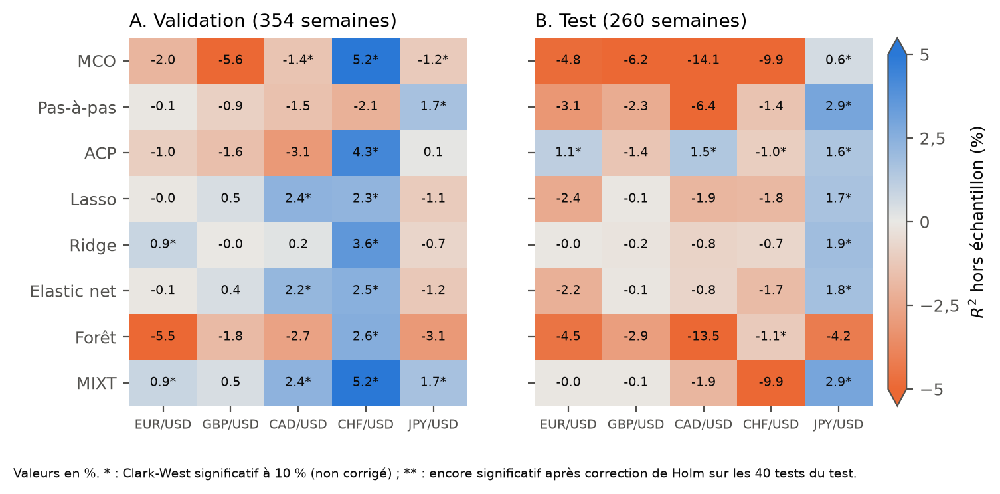

*La ligne MIXT de la validation est optimiste par construction : MIXT y choisit justement le meilleur
modèle de chaque colonne.*

**1.2 — Schéma de validation croisée pour λ** (`experiments/E1_2_cv_lambda/`).

| Schéma | $R^2$ de validation moyen (15 cas) | $R^2_{OS}$ de test moyen |
|---|---|---|
| Plis aléatoires (actuel) | **+0,55 %** (retenu) | −0,49 % |
| Blocs + tampon de 26 semaines | +0,50 % | −1,12 % |
| *Forward-chaining* + tampon de 26 semaines | −0,03 % | **+0,20 %** |

- **Choix selon la règle fixée d'avance :** le schéma aléatoire actuel, parce qu'il a le meilleur R²
  de validation. Ce choix ne dépend pas du test.
- **Ce que montre le test, rapporté honnêtement :** c'est le *forward-chaining* qui y fait le mieux, et
  c'est le seul schéma dont le $R^2_{OS}$ moyen est positif. La validation n'a donc pas su désigner le
  meilleur schéma. Les écarts restent très petits, de l'ordre de 0,5 point de R².
- **Ce que montre la figure :** avec les plis aléatoires, le λ choisi saute d'une semaine à l'autre, sur
  presque un ordre de grandeur. Les schémas temporels donnent un λ beaucoup plus stable, et le
  *forward-chaining* choisit systématiquement une pénalité plus forte. C'est cohérent avec l'idée qu'une
  validation croisée qui mélange des semaines voisines sous-estime l'erreur et pousse vers des modèles
  moins régularisés (Racine, 2000 ; Bergmeir et Benítez, 2012). Mais l'écart de précision reste trop
  faible pour trancher, ce qui rejoint Bergmeir, Hyndman et Koo (2018).
- **Contrôle :** le schéma aléatoire recalculé redonne exactement les prévisions de la référence E0.

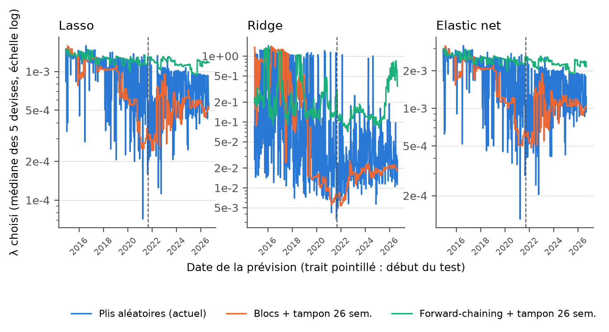

**1.3 — Réglage de la forêt aléatoire** (`experiments/E1_3_rf_tuning/`, 29 minutes de calcul).
- **Réglage retenu sur la validation :** feuilles d'au moins 25 observations, 3 variables par division.
  Son R² de validation moyen est de −0,11 %, contre −2,32 % pour le réglage de l'ancien projet.
- **Sur le test, une seule évaluation :** $R^2_{OS}$ moyen de −0,15 %, contre −5,23 % pour le réglage
  de l'ancien projet. Le réglage corrige donc presque entièrement le sur-ajustement de la forêt.
- **Ce que montre la grille :** les petites feuilles (5) et l'usage de toutes les variables (*bagging*)
  sont les pires réglages. Avec un signal très faible, des arbres profonds et peu décorrélés apprennent
  surtout le bruit. C'est l'argument de variance de la forêt (ESL §15.4.1 ; Breiman, 2001). Cela confirme
  aussi que le réglage peut améliorer nettement les valeurs par défaut (Probst, Wright et Boulesteix,
  2019).
- La forêt réglée reste toutefois sans pouvoir de classement entre les devises : sa corrélation de rang
  sur le test est d'environ 0.

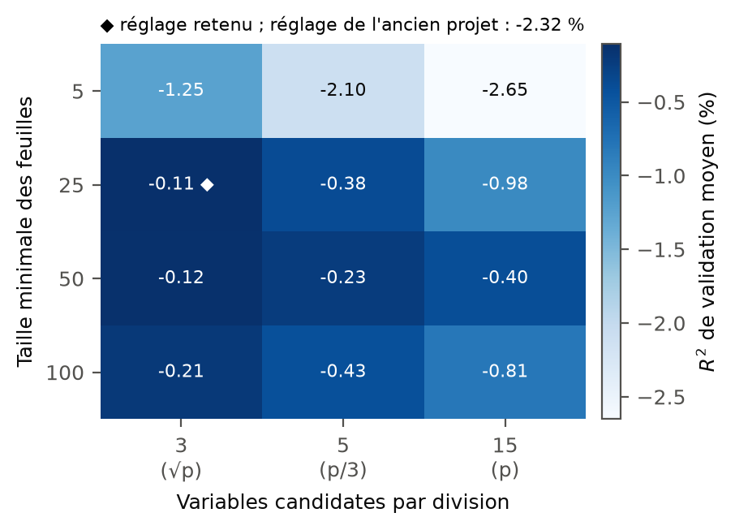

**1.4 — Sélection ou combinaison** (`experiments/E1_4_combinaison/`). Les membres sont les 7 modèles
appris, avec la validation croisée retenue en 1.2 et la forêt réglée en 1.3.

| Variante | $R^2_{OS}$ validation | $R^2_{OS}$ test | Corrélation de rang, test |
|---|---|---|---|
| MIXT (ancien = mis à jour) | +2,12 %* | −1,80 % | 0,044 |
| Moyenne simple | +1,00 % | **−0,32 %** | 0,047 |
| Stacking | +2,23 %* | −1,12 % | 0,047 |
| Meilleur modèle seul sur le test : ACP | −0,26 % | +0,35 % | 0,031 |
| Meilleur modèle seul pour le classement : pas-à-pas | −0,58 % | −2,08 % | 0,069 |

*\* Optimiste par construction : MIXT et le stacking sont ajustés sur ces mêmes semaines de validation.*

- **MIXT mis à jour :** il choisit exactement les mêmes modèles que l'ancien MIXT, car la forêt réglée
  n'est jamais la meilleure en validation. Les deux lignes sont donc identiques.
- **La moyenne simple fait mieux que MIXT sur le test** (−0,32 % contre −1,80 % de $R^2_{OS}$), avec un
  classement aussi bon. Le stacking se situe entre les deux.
- **Les poids du stacking se concentrent** sur le modèle que MIXT choisit déjà : 66 à 88 % du poids selon
  la devise, avec un peu de forêt et de MCO. Le stacking ressemble donc à un « MIXT adouci », et il
  hérite en partie de son instabilité.
- **Comparaison avec la littérature :** c'est exactement le *forecast combination puzzle*. Une
  combinaison à poids égaux bat la sélection et la combinaison à poids estimés, parce que l'estimation
  des poids, ou le choix d'un gagnant, ajoute de la variance (Bates et Granger, 1969 ; Smith et Wallis,
  2009 ; Claeskens et al., 2016). Rapach, Strauss et Zhou (2010) observent la même chose pour la prime de
  risque des actions.

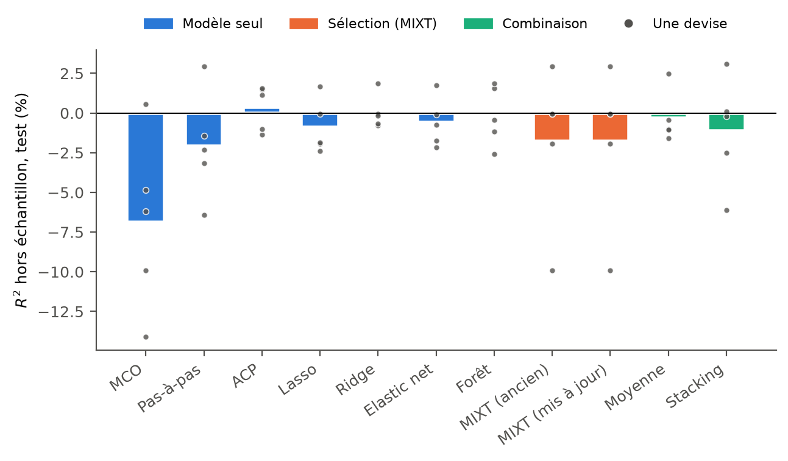

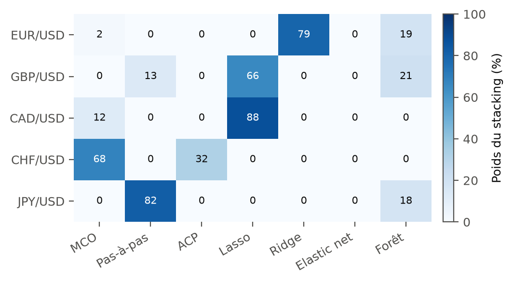

**1.5 — Stabilité de la sélection MIXT** (`experiments/E1_5_stabilite_mixt/`, 2 000 tirages, blocs de
8 semaines).

| Devise | Modèle choisi par MIXT | Fréquence où il serait rechoisi |
|---|---|---|
| EUR/USD | Ridge | 72 % |
| GBP/USD | Lasso | 35 % |
| CAD/USD | Lasso | 80 % |
| CHF/USD | MCO | 59 % (ACP : 29 %) |
| JPY/USD | Pas-à-pas | 70 % |

- Le choix de MIXT change souvent quand on rééchantillonne la validation ; pour GBP/USD, il ne tient que
  dans un tirage sur trois. C'est le sur-ajustement de la sélection décrit par Cawley et Talbot (2010).
  Cela explique pourquoi MIXT se généralise mal au test (1.1, 1.4) et pourquoi la moyenne fait mieux.

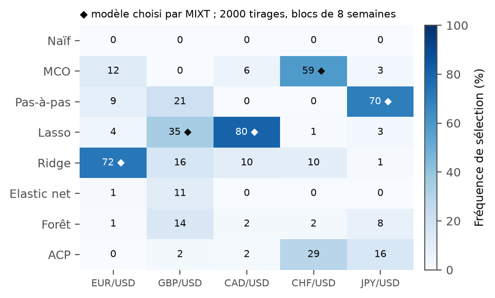

**1.6 — Interprétation** (`experiments/E1_6_importance/`, script `e1_6_importance.py`).

*Règle fixée avant le calcul.* L'importance dans la forêt réglée (feuilles ≥ 25, 3 variables) est
mesurée **par permutation**, et non par la réduction d'impureté de l'ancien projet, qui est biaisée
(Strobl et al., 2007) et donnait des importances presque toutes égales (5,5 % à 8,5 %). La forêt est
entraînée sur les 529 premières semaines. On mélange ensuite une variable à la fois sur les 354
semaines de validation, 30 fois, et on mesure la perte de R² (Breiman, 2001). La mesure se fait ainsi
sur des données que la forêt n'a pas vues, sans toucher au test. Les fréquences de sélection des
modèles linéaires viennent de la référence E0 ; elles ne changent pas, puisque le schéma de validation
croisée retenu est celui de l'ancien projet.

*Résultats.*
- **Les importances sont minuscules.** La variable la plus importante fait perdre au plus 0,3 point de
  R² quand on la mélange. C'est cohérent avec un modèle dont le R² de validation est lui-même proche de
  zéro (entre −0,7 % et +1,4 % selon la devise, pour cette forêt unique).
- Seules deux variables ont un intervalle qui exclut zéro : **le rendement de la semaine passée**
  (+0,32 point) et **la volatilité sur 4 semaines** (+0,29 point). Toutes deux sont des variables
  techniques de la devise elle-même. Les variations des taux US ont même une importance légèrement
  négative : les mélanger améliore un peu la prévision, ce qui veut dire que la forêt les sur-ajuste.
- **Limite :** l'intervalle ne reflète que le hasard des permutations. Il ne tient pas compte de
  l'incertitude sur la forêt elle-même ni de l'échantillon, et il faut donc le lire avec prudence.
- **Modèles linéaires :** ils ne s'entendent pas d'une devise à l'autre. Le pas-à-pas garde presque
  toujours une ou deux variables par devise, mais jamais les mêmes : le Δ écart 10 ans pour CAD et CHF,
  le rendement de l'or et du pétrole pour GBP, le rendement retardé pour CAD et JPY. Le Lasso et
  l'Elastic net retiennent beaucoup de variables pour CHF, et presque aucune pour GBP. L'absence d'un
  noyau de variables commun à toutes les devises est un autre signe d'un signal faible et instable.
- **Comparaison avec la littérature :** Gu, Kelly et Xiu (2020) trouvent, sur les actions, que les
  variables les plus importantes sont des variables de prix récents (momentum, liquidité, volatilité),
  communes à presque tous leurs modèles. Nous retrouvons la même famille (rendement retardé, volatilité
  récente) pour la forêt, mais avec des effets beaucoup plus faibles et sans accord entre les modèles.

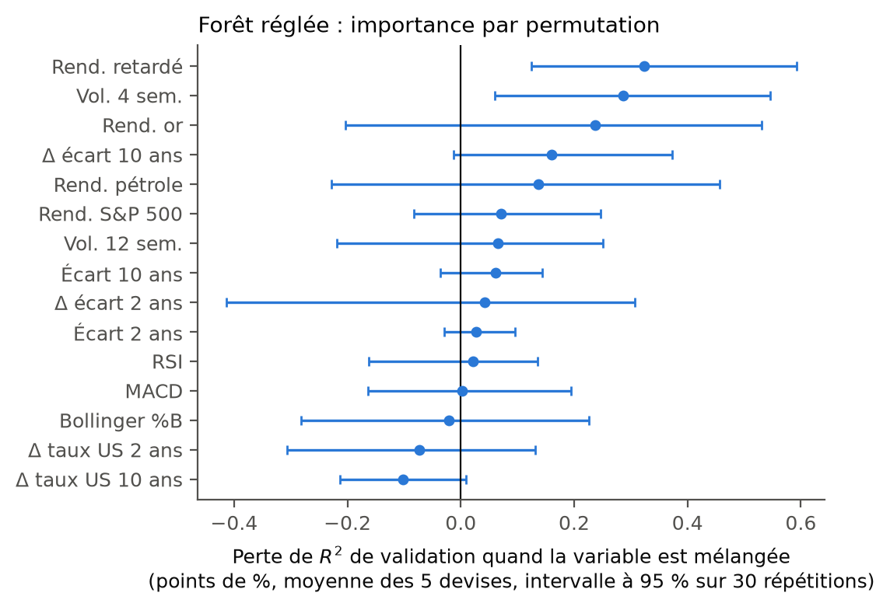

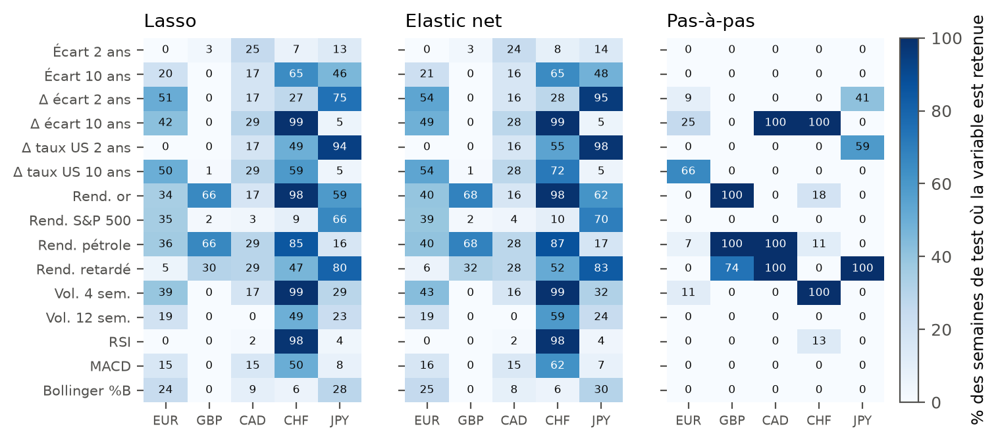

**Ce qu'il faut retenir de l'étape 1.**
1. Les rendements hebdomadaires sont presque imprévisibles : aucun modèle ne bat significativement la
   moyenne historique après correction pour tests multiples.
2. Choisir un modèle par devise (MIXT) est instable et se généralise moins bien qu'une simple moyenne
   des modèles.
3. Les bons réglages (forêt) réduisent beaucoup les dégâts du sur-ajustement, sans créer de signal.

**Point ouvert pour l'étape 4.** Quelle prévision de rendement envoyer dans l'ablation ? La règle prévue
était « la variante retenue sur la validation ». Mais MIXT et le stacking sont ajustés sur cette même
validation, alors que la moyenne ne l'est pas : leurs R² de validation sont gonflés, et la comparaison
n'y est pas équitable. Il faudra choisir une règle avant l'étape 4.

### Étape 2 — Bloc ML 2 : prévoir la volatilité ☑
**Question.** Un modèle appris prévoit-il mieux la volatilité qu'une référence naïve ? Diviser par la
volatilité prévue améliore-t-il le classement des paires ?

**Ce que dit la littérature.**
- Contrairement aux rendements, la volatilité est persistante et donc prévisible (Bollerslev, 1986).
- La volatilité réalisée, calculée à partir des rendements de plus haute fréquence, est une mesure
  observable de la volatilité, et des modèles simples sur cette mesure prévoient bien, notamment pour les
  taux de change (Andersen, Bollerslev, Diebold et Labys, 2003).
- Le modèle HAR capte cette persistance avec trois moyennes de la volatilité passée (Corsi, 2009).
- Sur les taux de change, aucun des 330 modèles testés par Hansen et Lunde (2005) ne bat clairement le
  GARCH(1,1).
- Des méthodes d'apprentissage peuvent battre le HAR quand on leur donne des prédicteurs
  supplémentaires (Christensen, Siggaard et Veliyev, 2023).
- Comme la vraie volatilité n'est pas observée, il faut une fonction de perte robuste au bruit de la
  mesure ; QLIKE en fait partie (Patton, 2011).
- Côté stratégie, réduire l'exposition quand la volatilité prévue est élevée améliore le Sharpe
  (Moreira et Muir, 2017) ; c'est ce qui justifie de diviser le rendement prévu par la volatilité prévue.

**Comment ça guide nos tests.** On compare les modèles avec QLIKE plutôt qu'avec la seule RMSE (Patton,
2011), et on teste les écarts avec le test de Diebold et Mariano (1995), dans sa version corrigée pour les
petits échantillons (Harvey, Leybourne et Newbold, 1997). Le résultat de Hansen et Lunde (2005) donne une
hypothèse claire à vérifier : le HAR fait-il mieux que le GARCH sur nos devises ?

| # | Expérience | Métriques | Choix fait sur |
|---|---|---|---|
| 2.1 | GARCH(1,1), **HAR**, volatilité de la semaine passée, écart-type sur 12 semaines | RMSE, **QLIKE**, corrélation, test de Diebold-Mariano | validation (modèle retenu) |
| 2.2 | Ablation du signal : $\hat r$ seul, $\hat r/\hat\sigma_{GARCH}$, $\hat r/\hat\sigma_{HAR}$, $\hat r/\hat\sigma_{naïf}$ | corrélation de rang avec le Sharpe réalisé | validation |

**Règles fixées avant les calculs (pré-enregistrement).**
- **Forme du HAR.** Le modèle est estimé sur le logarithme de la volatilité réalisée, comme Andersen,
  Bollerslev, Diebold et Labys (2003). Les prévisions restent ainsi toujours positives et la distribution
  est moins asymétrique. On revient en niveau avec la correction log-normale :
  $\hat\sigma = \exp(\widehat{\log RV} + s^2/2)$, où $s^2$ est la variance des résidus. La régression est
  réestimée chaque semaine sur tout le passé, comme les autres modèles. Son échantillon d'entraînement
  commence à la même date que celui du GARCH.
- **Choix du modèle de volatilité pour le signal.** Un seul modèle pour toutes les devises : celui qui a
  la plus petite perte QLIKE moyenne sur les 5 devises de validation. Les quatre candidats sont le
  GARCH, le HAR, la volatilité réalisée de la semaine passée et l'écart-type sur 12 semaines. Le bloc 2
  est ainsi jugé sur sa propre tâche de prévision, avec une perte robuste au bruit de la mesure
  (Patton, 2011).
- **Tests.** Chaque modèle est comparé au GARCH par un test de Diebold et Mariano (1995) sur la perte
  QLIKE, bilatéral, avec la correction pour petits échantillons de Harvey, Leybourne et Newbold (1997).
  La variance de long terme est estimée par Newey-West (Newey et West, 1987), avec le nombre de retards
  $\lfloor 4 (n/100)^{2/9} \rfloor$, parce que les écarts de perte entre deux modèles de volatilité sont
  autocorrélés (règle de Newey et West, 1994). Sur le test, les 15 tests (3 modèles × 5 devises) sont corrigés par Holm, et on rapporte
  les succès à 5 % et à 10 %, comme à l'étape 1.
- **Ablation du signal (2.2).** Elle est faite pour deux prévisions de rendement : MIXT (la stratégie
  actuelle) et la moyenne simple (meilleure à l'étape 1). Signaux comparés : $\hat r$ seul, puis
  $\hat r/\hat\sigma$ pour chacun des quatre modèles de volatilité. Mesures :
  - la corrélation de rang hebdomadaire avec les rendements réalisés ;
  - la corrélation de rang avec le Sharpe réalisé ($r/RV$) ;
  - l'écart moyen de rendement entre la paire classée première et la paire classée dernière.

**Équations :**
- HAR (sur le log) : $\log RV_{t+1} = \beta_0 + \beta_1 \log RV_t + \beta_4 \log \overline{RV}_{t-3:t} + \beta_{12}\log \overline{RV}_{t-11:t} + \varepsilon_{t+1}$ ;
- QLIKE : $L(\sigma^2, h) = \sigma^2/h - \log(\sigma^2/h) - 1$.

**Figures à produire :**
- volatilité prévue et volatilité réalisée pour une paire ;
- QLIKE par modèle et par paire.

**Résultats.** Script `Code/experiments/e2_volatilite.py`, résultats dans `experiments/E2_volatilite/`.
Toutes les variantes ont été évaluées une seule fois sur le test.

**2.1 — Précision des prévisions de volatilité.**

| Modèle | QLIKE validation | QLIKE test | RMSE test (points de %) | Corrélation test |
|---|---|---|---|---|
| GARCH(1,1) | 0,561 | 0,415 | 0,51 | 0,32 |
| **HAR (log)** | **0,543** (retenu) | **0,401** | **0,47** | **0,39** |
| Volatilité réalisée de la semaine passée | 1,170 | 1,274 | 0,60 | 0,29 |
| Écart-type sur 12 semaines | 0,723 | 0,553 | 0,52 | 0,26 |

*Moyennes sur les 5 devises.*

- **Choix selon la règle fixée d'avance :** le HAR, qui a la plus petite QLIKE de validation. Il reste
  le meilleur sur le test, selon les trois mesures.
- **Tests contre le GARCH sur le test** (Diebold-Mariano, 15 tests) :
  - le HAR est meilleur sur 4 devises sur 5, mais l'écart n'est significatif que pour EUR et CAD sans
    correction, et pour aucune après Holm ;
  - les deux références naïves sont moins bonnes que le GARCH dans 8 tests sur 10 sans correction, et
    encore dans 3 tests à 5 % (5 à 10 %) après Holm.
- **Comparaison avec la littérature :**
  - les deux modèles appris battent nettement les références naïves, ce qui confirme que la volatilité
    est prévisible, contrairement aux rendements (Bollerslev, 1986 ; Andersen et al., 2003) ;
  - le HAR fait un peu mieux que le GARCH, sans que l'écart soit statistiquement établi. C'est cohérent
    avec Hansen et Lunde (2005), pour qui le GARCH(1,1) est très difficile à battre sur le change, et
    avec Corsi (2009), pour qui un modèle aussi simple que le HAR est compétitif ;
  - la volatilité de la semaine passée, prise seule, est trop bruitée : c'est le problème de la mesure
    imparfaite discuté par Patton (2011).

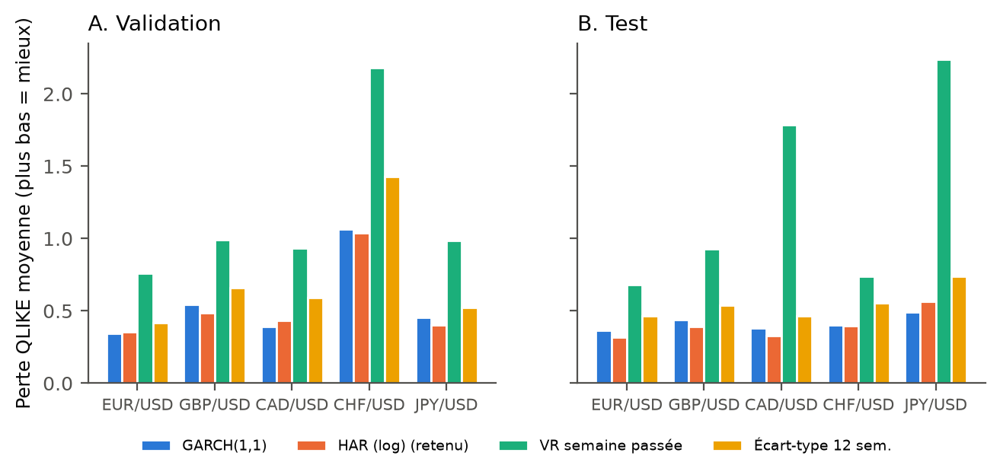

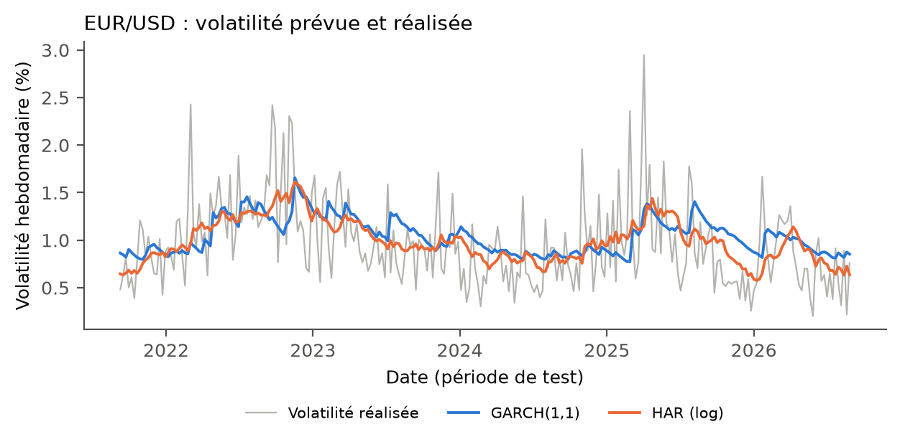

**2.2 — Ablation du signal : diviser par la volatilité aide-t-il à classer les devises ?**

| Signal | IC validation (MIXT) | IC test (MIXT) | Écart haut − bas, test (MIXT, pb/sem.) | IC validation (moyenne) | IC test (moyenne) |
|---|---|---|---|---|---|
| $\hat r$ seul | 0,032 | **0,044** | **9,1** | 0,019 | 0,047 |
| $\hat r/\hat\sigma$ GARCH (stratégie actuelle) | 0,023 | 0,040 | 7,1 | 0,027 | **0,049** |
| $\hat r/\hat\sigma$ HAR | 0,031 | 0,037 | 6,3 | 0,020 | 0,040 |
| $\hat r/\hat\sigma$ semaine passée | 0,042 | 0,045 | 6,0 | 0,028 | 0,039 |
| $\hat r/\hat\sigma$ 12 semaines | 0,024 | 0,044 | 6,7 | 0,029 | 0,044 |

*IC = corrélation de rang hebdomadaire moyenne avec les rendements réalisés. Aucune n'a une statistique
t supérieure à 1,5 ; les corrélations avec le Sharpe réalisé sont dans `ablation_signal.csv`.*

- **Diviser par la volatilité prévue n'améliore pas le classement.** Avec MIXT, le signal $\hat r$ seul
  classe aussi bien ou mieux que tous les signaux ajustés, et donne le plus grand écart entre la paire
  classée première et la dernière. Avec la moyenne, les écarts sont minimes et changent de sens entre la
  validation et le test.
- **Paradoxe à souligner dans le rapport :** le HAR est la meilleure prévision de volatilité (2.1), mais
  il ne donne pas le meilleur signal (2.2). Bien prévoir la volatilité ne suffit pas à mieux classer des
  rendements dont la prévision est elle-même presque du bruit.
- **Comparaison avec la littérature :** Moreira et Muir (2017) montrent qu'ajuster l'exposition à la
  volatilité *dans le temps* améliore le Sharpe. Notre division agit autrement : elle compare des
  devises *entre elles* au même moment. Leur résultat ne s'applique donc pas directement, et nos chiffres
  ne montrent pas de gain de classement. C'est une nuance à expliquer dans le rapport.

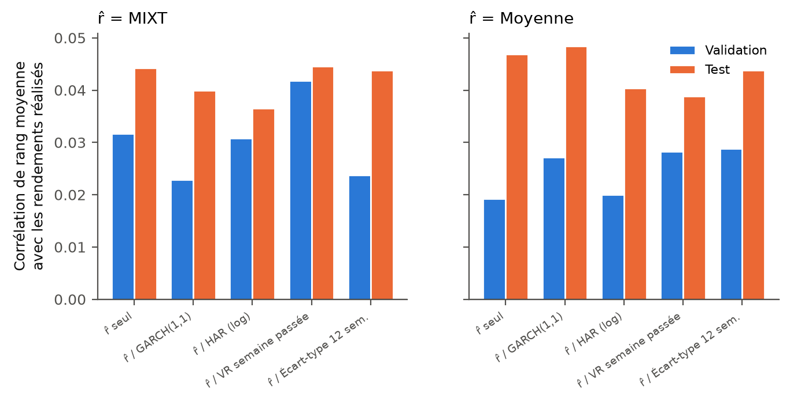

**Ce qu'il faut retenir de l'étape 2.**
1. Le bloc volatilité fonctionne comme tâche de ML : les modèles appris prévoient nettement mieux que les
   références naïves, et le HAR fait un peu mieux que le GARCH.
2. Mais cette meilleure prévision n'améliore pas le classement des devises : l'apport du bloc 2 au signal
   est nul ou légèrement négatif.
3. La question de recherche suppose que les trois blocs se complètent. À ce stade, le bloc 2 n'apporte
   rien au classement ; l'ablation de bout en bout (étape 4) dira s'il apporte quelque chose au risque de
   la stratégie.

### Étape 3 — Bloc ML 3 : le méta-classifieur (priorité n° 1) ☑
**Question.** Le méta-classifieur sépare-t-il les bonnes jambes des mauvaises mieux que le hasard, et
mieux qu'une règle simple de confiance ?

**Ce que dit la littérature.**
- Le méta-labeling consiste à garder un premier modèle pour le sens du pari, et à confier à un second
  modèle la décision d'agir ou non (López de Prado, 2018). Joubert (2022) en propose un cadre complet, et
  Meyer, Barziy et Joubert (2023) insistent sur la calibration des probabilités. Ces travaux viennent
  surtout de praticiens, et l'apport réel du filtre est rarement testé contre le hasard.
- En ML, décider de ne pas agir s'appelle la **classification avec option de rejet**. Chow (1970) en a
  posé le compromis entre erreur et rejet ; Herbei et Wegkamp (2006), puis El-Yaniv et Wiener (2010), en
  ont donné la théorie ; Geifman et El-Yaniv (2017) évaluent ces classifieurs par leur **courbe
  risque-couverture**.
- La qualité des probabilités se mesure par le score de Brier (Brier, 1950) et par des courbes de
  calibration (Niculescu-Mizil et Caruana, 2005). La capacité à classer se mesure par l'AUC (Fawcett,
  2006).
- Pour savoir si un classifieur a trouvé une vraie structure, on compare sa performance à celle obtenue
  après avoir mélangé les étiquettes (Ojala et Garriga, 2010).

**Comment ça guide nos tests.** C'est ici que se joue la nouveauté du projet. Nous évaluons le
méta-classifieur avec les outils de la classification sélective, et non seulement avec le Sharpe de la
stratégie. Nous le comparons à la règle de référence de ce domaine : rejeter quand la confiance du premier
modèle (ici |ŝ|) est faible, à la manière de la « *softmax response* » de Geifman et El-Yaniv (2017).

**Constat de départ (déjà vu, ancien projet) :**

| Jambe | N test | AUC | p (AUC > 0,5) | Brier | Brier de référence |
|---|---|---|---|---|---|
| Long | 196 | 0,531 | 0,23 | 0,2499 | 0,2487 |
| Short | 196 | 0,550 | 0,11 | 0,2470 | 0,2491 |

Pour les jambes longues, le Brier est *moins bon* que de toujours prédire le taux de gain moyen. Pourtant,
le Sharpe passe de 0,45 (sans filtre) à 0,88 (avec filtre). Il faut établir si ce gain vient du filtre ou
de la chance.

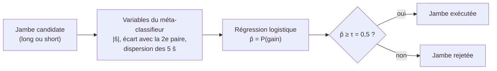

| # | Expérience | Métriques |
|---|---|---|
| 3.1 | Discrimination et calibration (déjà fait) | AUC, Brier contre le taux de base, courbe de calibration |
| 3.2 | **Placebo** : filtre aléatoire qui accepte la même proportion de jambes, 10 000 tirages | valeur p du gain de Sharpe observé |
| 3.3 | **Permutation des étiquettes** (Ojala et Garriga, 2010) | distribution de l'AUC sans pouvoir prédictif, valeur p |
| 3.4 | **Courbe risque-couverture** : méta-classifieur, règle sur \|ŝ\|, hasard | taux d'erreur selon la proportion de jambes acceptées, aire sous la courbe (AURC) |
| 3.5 | Sensibilité au seuil τ (rapportée, jamais optimisée) | Sharpe et taux de réussite selon τ, sur la validation |

**Règles fixées avant les calculs (pré-enregistrement).**
- **Jambes analysées.** Les 392 jambes de test (196 achats, 196 ventes) de la stratégie actuelle, MIXT
  et GARCH, exactement comme dans l'ancien projet. On teste ainsi la nouveauté telle qu'elle a été
  présentée. Le filtre sera réappliqué au signal final à l'étape 4.
- **Placebo (3.2).** 10 000 filtres au hasard qui gardent exactement autant de jambes que le vrai filtre,
  **de chaque côté** : 78 achats sur 196 et 146 ventes sur 196. Seule la sélection change ; l'exposition
  et la règle de financement restent celles de la stratégie. La valeur p est la proportion de placebos
  dont le Sharpe est au moins égal à celui du vrai filtre, calculée comme $(1 + \#)/(B + 1)$.
- **Permutation des étiquettes (3.3).** 1 000 permutations des étiquettes gain/perte, de chaque côté,
  sur toutes les jambes (validation et test). Pour chacune, on refait toute la procédure
  d'apprentissage en fenêtre croissante, puis on recalcule l'AUC sur le test. C'est le premier test
  d'Ojala et Garriga (2010) : il évalue tout l'apprentissage, pas seulement les probabilités finales.
- **Risque-couverture (3.4).** On classe les jambes de test de la plus « sûre » à la moins sûre selon
  trois scores : la probabilité $\hat p$ du méta-classifieur, la force du signal $|\hat s|$, et le hasard.
  On garde les c % premières, puis on mesure deux risques : le taux d'erreur ($1 -$ taux de gain), qui
  est la définition de Geifman et El-Yaniv (2017), et le rendement moyen des jambes gardées. Cette courbe
  est un diagnostic : elle classe toutes les jambes de test à la fois, ce qu'une règle utilisable en
  temps réel ne pourrait pas faire.

**Équation :** la régression logistique, $\hat p = 1/(1+\exp[-(\beta_0 + \beta^\top x)])$ (ESL §4.4 ;
diapos *nn*, p. 60, pour la sortie sigmoïde).

**Figures à produire :**
- courbe ROC et courbe de calibration (existe dans `ml_analysis.py`) ;
- histogramme du placebo avec la valeur observée ;
- courbes risque-couverture.

**Résultats.** Script `Code/experiments/e3_meta.py`, résultats dans `experiments/E3_meta/`. La stratégie
reconstruite redonne exactement le Sharpe publié (0,8765), et la version rapide de l'apprentissage en
fenêtre croissante redonne exactement les probabilités du backtest (contrôles intégrés au script).

**3.1 — Discrimination et calibration (test).**

| Côté | Jambes | Taux de gain | AUC | Valeur p (permutation, 3.3) | Brier | Brier de référence | Gain des jambes gardées / rejetées |
|---|---|---|---|---|---|---|---|
| Achats | 196 | 46,4 % | 0,531 | 0,136 | 0,2499 | 0,2487 | 50,0 % / 44,1 % |
| Ventes | 196 | 53,1 % | 0,550 | 0,065 | 0,2470 | 0,2491 | 54,1 % / 50,0 % |

- Les deux classifieurs séparent à peine mieux que le hasard (AUC 0,53 et 0,55).
- Pour les achats, les probabilités sont *moins bonnes* que de toujours prédire le taux de gain moyen
  (Brier 0,2499 contre 0,2487). La courbe de calibration n'a pas de pente nette.

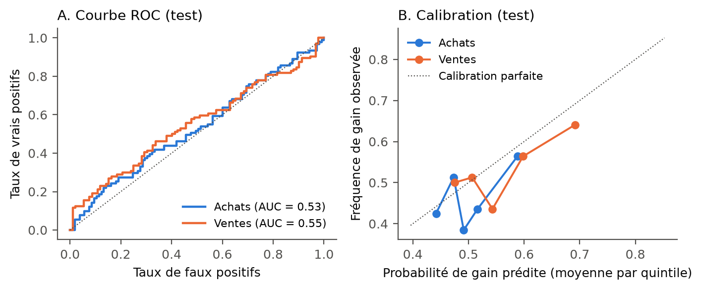

**3.2 — Placebo : le filtre bat-il le hasard ?**
- Sharpe avec le méta-classifieur : **0,88**. Sans filtre : 0,45.
- Les 10 000 filtres au hasard, qui gardent aussi 78 achats et 146 ventes, ont un Sharpe moyen de 0,48.
  90 % d'entre eux se situent entre −0,07 et 1,03.
- **Valeur p = 0,118 :** environ 12 % des filtres au hasard font au moins aussi bien que le
  méta-classifieur. **Le doublement du Sharpe n'est donc pas statistiquement distinguable de la
  chance**, ni à 5 % ni à 10 %.
- Le Sharpe moyen des placebos (0,48) est proche de celui de la stratégie sans filtre (0,45) : garder au
  hasard autant de jambes ne change rien en moyenne, mais la dispersion est énorme. Sur 260 semaines, le
  Sharpe d'une stratégie est très bruité.

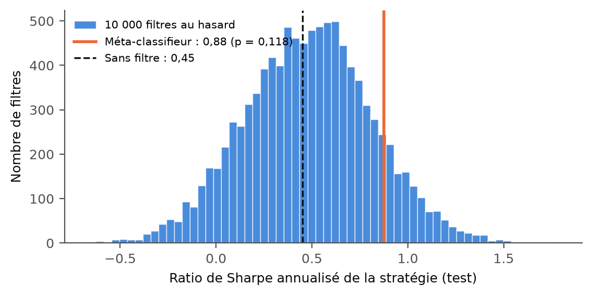

**3.3 — Permutation des étiquettes, avec réapprentissage complet (1 000 fois).**
- Achats : AUC observée 0,531, valeur p de 0,136. Ventes : AUC observée 0,550, valeur p de 0,065.
- L'AUC des ventes n'est significative qu'au seuil de 10 %, et l'AUC des achats ne l'est pas. Avec deux
  tests, la correction de Holm donnerait une valeur p de 0,13 pour les ventes.
- **Comparaison avec la littérature :** Ojala et Garriga (2010) proposent ce test précisément pour
  savoir si un classifieur a trouvé une vraie structure. Ici, la structure trouvée est au mieux faible,
  et limitée aux ventes.

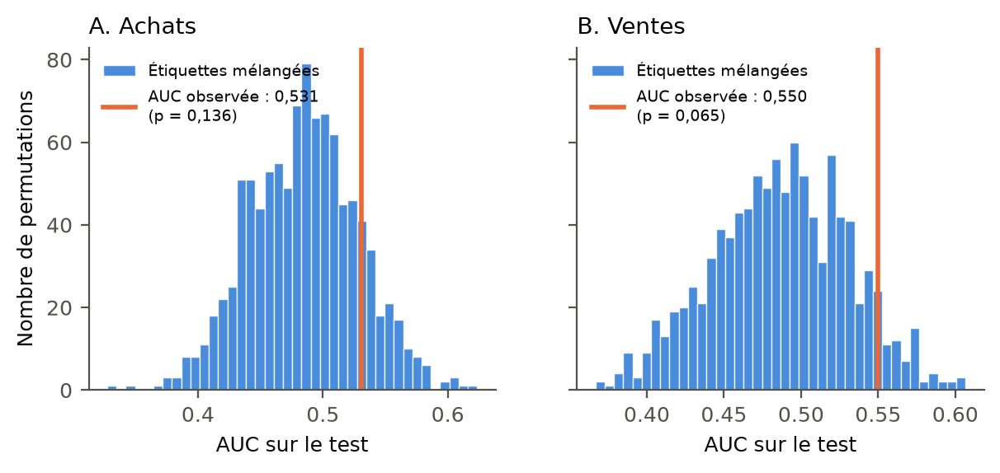

**3.4 — Courbes risque-couverture : le méta-classifieur fait-il mieux qu'une règle simple ?**

| Score de classement des jambes | Aire sous la courbe d'erreur (AURC) | Erreur à 57 % de couverture | Rendement moyen à 57 % (pb/sem.) |
|---|---|---|---|
| Probabilité du méta-classifieur | 0,447 | 47,3 % | 11 |
| **Force du signal $|\hat s|$** | 0,449 | **44,2 %** | **18** |
| Hasard | 0,502 | 50,3 % | 4 |

*57 % est la couverture du vrai filtre au seuil 0,5.*

- **Classer les jambes par confiance aide :** les deux scores battent nettement le hasard, surtout
  quand on ne garde qu'une petite partie des jambes.
- **Mais le méta-classifieur n'apporte rien de plus que la force du signal lui-même.** Les deux courbes
  d'erreur sont presque confondues, et au niveau de couverture du vrai filtre, la règle simple sur
  $|\hat s|$ fait même mieux, en erreur comme en rendement. C'est exactement la question que pose la
  classification sélective : un second modèle ne vaut la peine que s'il fait mieux que la confiance du
  premier (Geifman et El-Yaniv, 2017).
- **Limite de cette mesure :** la courbe classe toutes les jambes de test à la fois. C'est un
  diagnostic, pas une règle utilisable en temps réel.

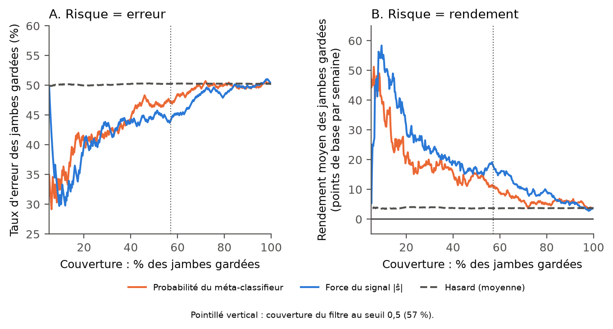

**3.5 — Sensibilité au seuil, sur la validation** (`seuils_validation.csv`, rapportée, jamais
optimisée).

| Côté | Seuil | Jambes gardées | Gain des gardées | Gain des rejetées |
|---|---|---|---|---|
| Achats | 0,50 | 62 | 54,8 % | **64,5 %** |
| Ventes | 0,50 | 87 | 47,1 % | **54,1 %** |

- **Sur la validation, au seuil retenu, le filtre garde de moins bonnes jambes que celles qu'il
  rejette,** des deux côtés. Rien dans la validation n'annonçait donc le gain observé sur le test.
- C'est un argument de plus pour voir le gain du test comme un résultat de la chance. Garder le seuil
  fixé *a priori* (0,5), au lieu de l'optimiser, évite au moins d'ajouter un biais de sélection.

**Ce qu'il faut retenir de l'étape 3.**
1. Le méta-classifieur, élément central de la nouveauté, n'a pas de pouvoir de séparation établi :
   AUC de 0,53 et 0,55, probabilités mal calibrées, permutation non significative à 5 %.
2. Le doublement du Sharpe (0,45 à 0,88) ne se distingue pas d'un filtre au hasard (p = 0,118), et la
   validation ne le laissait pas prévoir.
3. La force du signal du premier modèle est un score au moins aussi bon que le méta-classifieur. Le
   second modèle n'ajoute pas d'information.
4. **Comparaison avec la littérature :** López de Prado (2018) et Joubert (2022) présentent le
   méta-labeling comme un moyen de filtrer les faux positifs d'un signal primaire. Nos tests montrent
   que, sur un signal primaire aussi faible et avec quelques centaines de jambes, cet avantage ne se
   matérialise pas. Le gain apparent vient du bruit d'un Sharpe estimé sur 260 semaines. C'est le genre
   de faux positif que Bailey et López de Prado (2014) mettent en garde de ne pas confondre avec une
   vraie performance.

### Étape 4 — Ablation de bout en bout ☑
On ajoute **un bloc à la fois** pour mesurer sa contribution. La variante de chaque bloc est celle retenue
sur la validation.

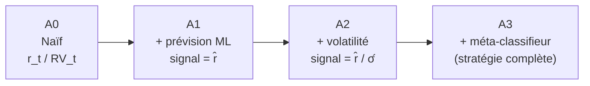

| Variante | Signal | Filtre |
|---|---|---|
| A0 | dernier rendement / dernière volatilité réalisée | aucun |
| A1 | $\hat r$ (MIXT ou combinaison retenue à l'étape 1) | aucun |
| A2 | $\hat r/\hat\sigma$ (volatilité retenue à l'étape 2) | aucun |
| A3 | $\hat r/\hat\sigma$ | méta-classifieur |
| A3-placebo | $\hat r/\hat\sigma$ | filtre aléatoire, même taux d'acceptation |

**Ce que dit la littérature.**
- Les rendements financiers sont autocorrélés en volatilité ; pour un intervalle de confiance sur un
  Sharpe, on rééchantillonne donc des blocs de semaines plutôt que des semaines isolées (Künsch, 1989 ;
  Politis et Romano, 1994 ; ESL §7.11).
- Quand plusieurs variantes de stratégie sont essayées, le meilleur Sharpe observé est biaisé vers le
  haut ; le *Deflated Sharpe Ratio* corrige ce biais en tenant compte du nombre d'essais (Bailey et López
  de Prado, 2014).
- Pour comparer plusieurs modèles sans en désigner un seul gagnant, l'ensemble de confiance de modèles
  (*Model Confidence Set*) retient tous ceux qui ne sont pas statistiquement battus (Hansen, Lunde et
  Nason, 2011).

**Règles fixées avant les calculs (pré-enregistrement).** À ce stade, les résultats de test des
étapes 1 à 3 ont déjà été vus. Pour ne pas choisir une « meilleure chaîne » après coup, l'ablation est
faite sur deux chaînes, avec des statuts différents.
- **Chaîne principale : celle de l'ancien projet** (MIXT, GARCH, méta-classifieur). Elle a été fixée
  avant toute nouvelle expérience, et c'est elle qui répond à la question validée par le professeur.
- **Chaîne secondaire, mise à jour et présentée comme exploratoire :**
  - volatilité : le HAR, retenu par la règle de l'étape 2 ;
  - prévision de rendement : choisie par **validation emboîtée**. On coupe la validation en deux
    moitiés de 177 semaines. MIXT et les poids du stacking sont ajustés sur la première moitié. MIXT, le
    stacking et la moyenne sont ensuite comparés sur la seconde moitié, qu'aucun n'a vue, selon leur
    R² moyen sur les 5 devises. Le gagnant est enfin réajusté sur toute la validation. Cette règle
    corrige le biais relevé à la fin de l'étape 1, sans utiliser le test (Cawley et Talbot, 2010) ;
  - méta-classifieur : même procédure que l'ancien projet (seuil 0,5), entraîné sur les jambes de
    validation de la chaîne mise à jour.
- **Intervalles de confiance :** à 95 %, par bootstrap en blocs de 8 semaines, avec 2 000 tirages.
- **Placebo de A3 :** 10 000 filtres au hasard qui gardent autant de jambes que le vrai filtre, de chaque
  côté, comme en 3.2.
- **Deflated Sharpe Ratio** (Bailey et López de Prado, 2014). Le nombre d'essais $N$ compte **toutes**
  les stratégies dont le Sharpe de test a été calculé dans le projet :
  - les 8 méthodes de l'ancien projet, MIXT et MIXT avec le méta-classifieur ;
  - les 3 variantes « corrigées » ;
  - les 10 signaux de l'ablation 2.2 (écart haut − bas) ;
  - les nouvelles variantes de cette étape.

  La variance des Sharpe entre ces essais sert de référence.

**Métriques :**
- Sharpe annualisé avec intervalle de confiance par bootstrap en blocs ;
- rang parmi les 1 000 stratégies aléatoires ;
- *Deflated Sharpe Ratio*, pour corriger le nombre de variantes essayées ;
- rendement, volatilité et perte maximale (finance brève) ;
- résultats par année.

**Figures à produire :**
- « escalier » d'ablation (Sharpe et intervalle de confiance, de A0 à A3) ;
- courbes de valeur des variantes.

**Résultats.** Script `Code/experiments/e4_ablation.py`, résultats dans `experiments/E4_ablation/`. La
chaîne d'origine reconstruite redonne exactement les Sharpe publiés : 0,452 sans filtre et 0,877 avec
le filtre (contrôles intégrés au script).

**Choix de la prévision de la chaîne mise à jour, par validation emboîtée** (`choix_emboite.csv`). Sur
la seconde moitié de la validation, la **moyenne simple** gagne : R² de 2,68 %, contre 2,28 % pour le
stacking et 2,11 % pour MIXT. Ajusté sur la première moitié, MIXT choisit déjà d'autres modèles que sur
toute la validation, par exemple la forêt pour GBP et JPY : c'est l'instabilité vue en 1.5. Cette règle,
qui n'utilise pas le test, mène à la même conclusion que l'étape 1.

**L'escalier d'ablation (test, 260 semaines).**

| Variante | Sharpe | IC à 95 % | Rang parmi 1 000 au hasard | DSR |
|---|---|---|---|---|
| A0 Naïf | 0,15 | [−0,76 ; 1,02] | 65 % | 0,19 |
| **Chaîne d'origine** | | | | |
| A1 + prévision MIXT ($\hat r$ seul) | 0,54 | [−0,43 ; 1,51] | 87 % | 0,50 |
| A2 + volatilité GARCH ($\hat r/\hat\sigma$) | 0,45 | [−0,41 ; 1,36] | 83 % | 0,42 |
| A3 + méta-classifieur | **0,88** | **[0,09 ; 1,83]** | 97 % | 0,77 |
| A3 placebo (même nombre de jambes) | 0,48 en moyenne | [−0,19 ; 1,14] | — | — |
| **Chaîne mise à jour (exploratoire)** | | | | |
| A1 + moyenne simple ($\hat r$ seul) | 0,57 | [−0,34 ; 1,57] | 91 % | 0,53 |
| A2 + volatilité HAR | 0,52 | [−0,37 ; 1,50] | 88 % | 0,48 |
| A3 + méta-classifieur | 0,74 | [−0,08 ; 1,58] | 96 % | 0,67 |
| A3 placebo (même nombre de jambes) | 0,72 en moyenne | [0,17 ; 1,28] | — | — |

*DSR : probabilité que le vrai Sharpe dépasse celui qu'on attendrait du meilleur de N = 29 essais faits
au hasard (Sharpe de référence de 0,544 par an) ; on parle de signal établi au-delà de 0,95. N compte
toutes les stratégies dont le Sharpe de test a été calculé dans le projet, y compris les deux stratégies
de l'étape 5 (LSTM et Ridge réestimée toutes les 52 semaines), ajoutées après coup selon la règle fixée
d'avance. Calculé d'abord avec N = 27, avant l'étape 5 : Sharpe de référence de 0,551 par an, DSR de
0,77 pour A3 d'origine (inchangé à deux décimales) et de 0,49 / 0,41 / 0,52 / 0,47 / 0,66 pour les
autres variantes. Le Sharpe de référence baisse légèrement en passant à 29, parce que les deux nouveaux
essais ont des Sharpe proches de la moyenne et réduisent la dispersion entre essais (liste complète :
`essais_pour_dsr.csv`).*

**Ce que chaque bloc apporte.**
- **Bloc 1, la prévision ML (A0 → A1) :** le Sharpe passe de 0,15 à 0,54 (origine) ou 0,57 (mise à
  jour). C'est le plus grand pas de l'escalier, mais les intervalles de confiance de A0 et de A1 se
  recouvrent presque entièrement.
- **Bloc 2, la volatilité (A1 → A2) :** le Sharpe *baisse* dans les deux chaînes, de 0,54 à 0,45 et de
  0,57 à 0,52. Cela confirme 2.2 : diviser par la volatilité prévue n'aide pas à classer les devises.
- **Bloc 3, le méta-classifieur (A2 → A3) :** le Sharpe monte, de 0,45 à 0,88 (origine) et de 0,52 à
  0,74 (mise à jour). Mais le placebo l'explique en bonne partie :
  - **chaîne d'origine :** 12 % des filtres au hasard font au moins aussi bien (p = 0,117, comme en 3.2) ;
  - **chaîne mise à jour :** p = 0,48. Le vrai filtre (0,74) ne fait pas mieux que la moyenne des filtres
    au hasard (0,72).

**Un effet mécanique découvert grâce au placebo : le financement.** Quand une seule jambe est gardée, la
stratégie paie le taux DFF (achat seul) ou le reçoit (vente seule). Or le filtre garde beaucoup plus de
ventes que d'achats :
- chaîne d'origine : 108 semaines avec la vente seule, contre 40 avec l'achat seul ;
- chaîne mise à jour : 121 contre 26.

Avec un DFF moyen de 3,5 % par an sur la période de test, le filtre encaisse donc des intérêts
indépendamment de toute prévision :
- **0,95 point de rendement par an** dans la chaîne d'origine. Sans ce financement, le Sharpe de A3
  tombe de 0,88 à 0,73 ;
- **1,47 point par an** dans la chaîne mise à jour. Sans ce financement, le Sharpe de A3 tombe de 0,74 à
  0,54, c'est-à-dire au niveau de A2 (0,52). Le gain du filtre y est entièrement mécanique.

C'est pour cela que le placebo garde le même nombre de jambes *de chaque côté* : il reproduit ce
déséquilibre et isole ce qui revient vraiment à la prévision.

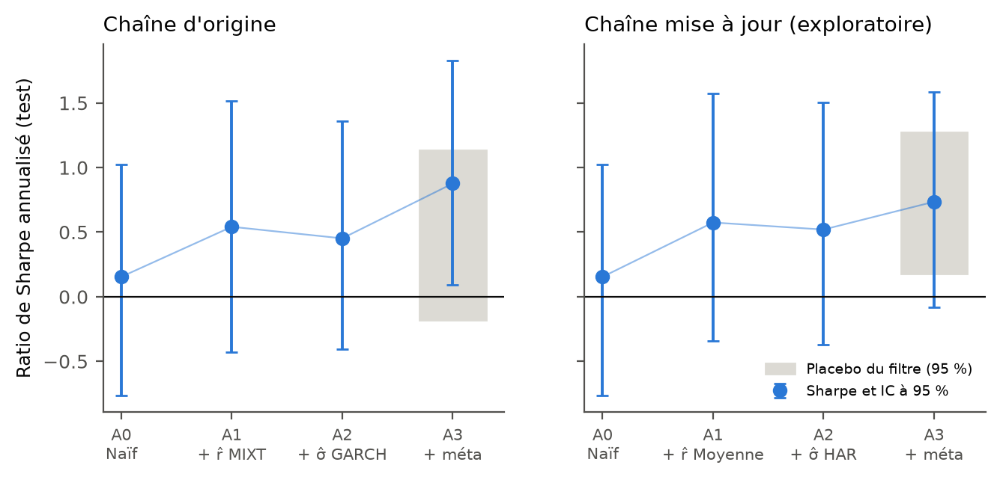

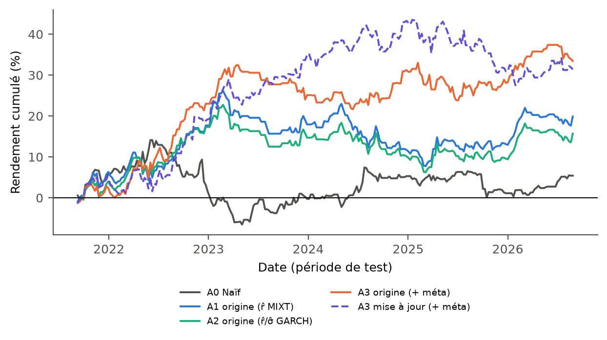

**Robustesse dans le temps** (`ablation_annees.csv`). Les rendements varient fortement d'une année à
l'autre. La chaîne d'origine avec filtre gagne surtout en 2022 (+18 %) ; la chaîne mise à jour perd 9 %
en 2025. Aucune variante n'est positive chaque année.

**Comparaison avec la littérature.**
- Avec 260 semaines, l'intervalle de confiance d'un Sharpe annualisé fait environ ±0,9. Il faut un
  Sharpe très élevé, ou une période bien plus longue, pour distinguer une stratégie du hasard. C'est le
  point central de Bailey et López de Prado (2014) : après N = 29 essais, le meilleur Sharpe qu'on
  attendrait du seul hasard est déjà de 0,54 par an, et aucune variante n'atteint un DSR de 0,95.
- La baisse due au bloc volatilité rappelle que le résultat de Moreira et Muir (2017), un ajustement dans
  le temps, ne se transpose pas à une comparaison entre devises (étape 2).
- Le gain du méta-classifieur, qu'un placebo explique, illustre la mise en garde de López de Prado
  (2018) lui-même sur le sur-ajustement des backtests.

**Ce qu'il faut retenir de l'étape 4 (réponse à la question de recherche).**
1. La chaîne complète affiche un Sharpe de 0,88 sur le test, et c'est la seule variante dont
   l'intervalle de confiance exclut zéro. Mais ce résultat ne survit ni au placebo (p = 0,12), ni à la
   correction pour le nombre d'essais (DSR 0,77 < 0,95). Une partie vient d'un effet mécanique de
   financement.
2. Pris un à un, les blocs ML apportent peu. La prévision ML donne le plus grand gain, mais il reste
   imprécis ; la volatilité fait baisser le Sharpe ; le filtre ne fait pas mieux que le hasard une fois le
   financement contrôlé.
3. **Réponse honnête à la question validée :** sur cinq devises à l'horizon hebdomadaire, la combinaison
   proposée ne produit pas un signal *dont on puisse établir statistiquement la fiabilité*. La
   performance observée est compatible avec la chance. C'est un résultat négatif, établi
   rigoureusement : le barème note la qualité de la démonstration, pas la performance.

### Étape 5 — Complément : LSTM ☑
Cette étape n'est faite qu'une fois l'étape 4 terminée. **Ce n'est pas le cœur du projet.**

**Ce que dit la littérature.**
- Le LSTM a été conçu pour apprendre des dépendances longues sans que le gradient s'évanouisse
  (Hochreiter et Schmidhuber, 1997 ; diapos *rnn-cnn*, p. 38).
- Sur les actions, Fischer et Krauss (2018) trouvent qu'un LSTM bat une forêt aléatoire et une régression
  logistique pour prévoir la direction des rendements journaliers.
- Mais dans une large étude empirique, les réseaux récurrents sont des concurrents valables, pas des
  solutions universelles (Hewamalage, Bergmeir et Bandara, 2021), et sur des données tabulaires de taille
  moyenne, les arbres restent souvent meilleurs que les réseaux profonds (Grinsztajn, Oyallon et
  Varoquaux, 2022).
- Le résultat d'un réseau varie avec la graine aléatoire ; il faut donc en entraîner plusieurs et rapporter
  la variabilité (Bouthillier et al., 2021), ou faire la moyenne d'un ensemble de réseaux
  (Lakshminarayanan, Pritzel et Blundell, 2017).

**Comment ça guide le test.**
- **Modèle :** un LSTM à 5 sorties, qui prédit le vecteur des rendements des 5 paires (apprentissage
  multitâche, Caruana, 1997). Entrée : les *L* dernières semaines des variables.
- **Protocole :**
  - même découpage que les autres modèles ;
  - arrêt précoce sur un bloc de validation temporel (diapos *nn*, p. 61) ;
  - ensemble de plusieurs graines ;
  - ré-estimation périodique, avec la même fréquence appliquée à une Ridge de référence pour que la
    comparaison soit équitable.
- **Métriques :** les mêmes qu'à l'étape 1. Le LSTM est aussi branché dans A1, à titre de variante.

**Règles fixées avant les calculs (pré-enregistrement).**
- **Entrée.** À chaque semaine $t$, le vecteur des 55 variables distinctes des 5 paires : 10 variables
  propres à chaque paire (4 de taux, 6 techniques) et 5 variables communes (variations des taux US à
  2 et 10 ans, or, S&P 500, pétrole). Le réseau voit la séquence des $L$ dernières semaines, de $t-L+1$
  à $t$.
- **Sortie.** Le vecteur des 5 rendements de la semaine suivante (apprentissage multitâche, Caruana,
  1997).
- **Standardisation.** Entrées et cibles sont standardisées avec la moyenne et l'écart-type de la
  fenêtre d'entraînement seulement, puis les prévisions sont ramenées à l'échelle des rendements.
- **Architecture et entraînement.**
  - une couche LSTM suivie d'une couche linéaire à 5 sorties, avec une perte quadratique ;
  - optimiseur Adam (taux de 0,001), lots de 64, au plus 200 époques ;
  - arrêt précoce, avec une patience de 20 époques, sur les derniers 20 % *chronologiques* de chaque
    fenêtre d'entraînement. On garde les poids de la meilleure époque.
- **Réestimation toutes les 52 semaines**, en fenêtre croissante : le modèle est entraîné au début de
  chaque bloc de 52 semaines sur tout le passé, puis prévoit chaque semaine du bloc. Une **Ridge de
  référence** est réestimée exactement aux mêmes dates : par paire, avec ses 15 variables, et λ choisi
  par la validation croisée retenue à l'étape 1. Seule différence avec la Ridge de l'étape 1, qui était
  réestimée chaque semaine : la fréquence.
- **Réglage.** Grille de 4 réglages : unités cachées dans {8, 32}, longueur de séquence $L$ dans
  {4, 12} semaines. Le réglage retenu est **un seul** pour toutes les devises : celui qui a le meilleur
  R² de validation moyen sur les 5 devises. Seul ce réglage est ensuite évalué, une fois, sur le test.
- **Graines.** 5 graines par réglage. La prévision est la moyenne des 5 réseaux (Lakshminarayanan et al.,
  2017), et on rapporte la dispersion entre graines (Bouthillier et al., 2021).
- **Nombre d'essais.** La stratégie A1 avec le LSTM est un essai de plus pour le Deflated Sharpe Ratio
  (N passe de 27 à 29, car la Ridge de comparaison donne aussi une stratégie évaluée sur le test).

**Résultats.** Script `Code/experiments/e5_lstm.py`, résultats dans `experiments/E5_lstm/`. PyTorch
2.15.0 (processeur), dont la version est ajoutée à `requirements-lock.txt`. Les entraînements sont
déterministes : relancer le script redonne exactement les mêmes chiffres. Le calcul complet prend
18 secondes.

**Réglage sur la validation** (`grille_validation.csv`).

| Unités cachées | L (semaines) | R² de validation moyen (ensemble de 5) | R² d'une graine seule (min ; max) | Époques retenues (moyenne) |
|---|---|---|---|---|
| 8 | 4 | −0,55 % | −5,4 % ; −2,1 % | 25 |
| 8 | 12 | −0,40 % | −5,7 % ; −1,9 % | 24 |
| **32** | **4** | **−0,34 %** (retenu) | −3,7 % ; −0,4 % | 7 |
| 32 | 12 | −0,56 % | −2,8 % ; −0,7 % | 7 |

- Aucun réglage n'atteint un R² positif en validation.
- L'arrêt précoce s'arrête très tôt, après 7 époques en moyenne pour 32 unités : dès que le réseau
  commence à apprendre la fenêtre d'entraînement, il se dégrade sur la fin de cette fenêtre. Il
  n'apprend que du bruit.

**Test, une seule fois, pour le réglage retenu.**

| Modèle (réestimé toutes les 52 semaines) | $R^2_{OS}$ validation | $R^2_{OS}$ test | Corrélation de rang, test | Sharpe de la stratégie A1, test [IC à 95 %] |
|---|---|---|---|---|
| LSTM à 5 sorties (moyenne de 5 graines) | −0,12 % | **−0,43 %** | −0,008 | 0,34 [−0,64 ; 1,20] |
| Ridge de référence | +0,81 % | −1,10 % | 0,012 | 0,36 [−0,53 ; 1,28] |

- **En précision**, le LSTM fait mieux que la Ridge réestimée aux mêmes dates (−0,43 % contre −1,10 %),
  mais reste sous la moyenne historique.
- **En classement des devises**, ce qui compte pour la stratégie, le LSTM ne fait rien : sa corrélation
  de rang est nulle. Le Sharpe de la stratégie A1 est le même que celui de la Ridge (0,34 contre 0,36),
  avec des intervalles de confiance très larges qui contiennent zéro.
- **L'ensemble de graines fait l'essentiel du travail :** chaque réseau seul a un $R^2_{OS}$ de test
  entre −2,3 % et −1,8 %, alors que leur moyenne est à −0,43 %. Moyenner des réseaux qui ont surtout
  appris du bruit ramène la prévision vers la moyenne. C'est la réduction de variance attendue d'un
  ensemble (Lakshminarayanan et al., 2017), et cela montre pourquoi une graine unique serait trompeuse
  (Bouthillier et al., 2021).
- **Comparaison avec l'étape 1 :** la Ridge réestimée chaque semaine faisait mieux sur le test (+0,04 %)
  que la Ridge réestimée toutes les 52 semaines (−1,10 %). La fréquence de réestimation coûte donc
  autant que le choix du modèle. C'est pourquoi le LSTM est comparé à une Ridge de *même fréquence*, et
  non à celle de l'étape 1.

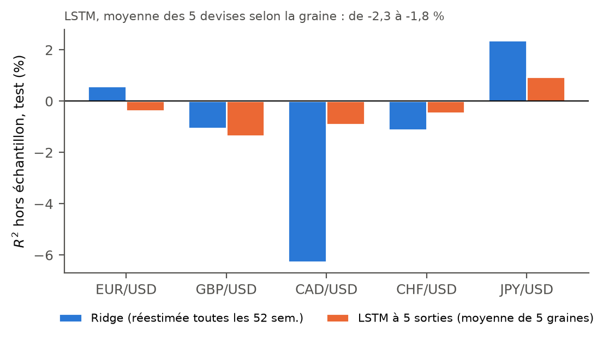

**Comparaison avec la littérature.**
- Le résultat rejoint Hewamalage, Bergmeir et Bandara (2021) : les réseaux récurrents ne sont pas une
  solution universelle. Il rejoint aussi Makridakis, Spiliotis et Assimakopoulos (2018) : avec peu de
  données et un signal faible, des méthodes simples font aussi bien.
- Il nuance Fischer et Krauss (2018) : leur LSTM disposait de données journalières sur des centaines
  d'actions, donc de bien plus d'exemples que nos 529 à 1 100 semaines.
- Il confirme l'intuition du professeur, qui doutait que le LSTM fonctionne ici, et va dans le sens de
  Grinsztajn et al. (2022) pour des données tabulaires de taille moyenne.

**Ce qu'il faut retenir de l'étape 5.** Le LSTM multitâche a été essayé avec un protocole équitable :
même découpage, Ridge de même fréquence, réglage sur la validation, ensemble de graines. Il ne trouve
pas de structure exploitable, et son seul avantage en précision vient de l'effet de moyenne de
l'ensemble. Cela renforce la conclusion de l'étape 4.

### Étape 6 — Revue de littérature ML ☑
La carte de la littérature, prête pour la section « travaux reliés » du rapport, est à la section 9.
Chaque étape terminée compare son résultat à la littérature citée.

**Vérifications faites.**
- **Les 75 références de la bibliographie sont toutes vérifiées.** 42 ont été comparées aux
  métadonnées officielles de Crossref : titre, auteurs, revue, volume, numéro, pages et DOI. 30 ont été
  vérifiées sur le site de la revue, de la conférence ou d'un dépôt reconnu (JMLR, NeurIPS, arXiv, NBER,
  CEPR, RePEc), surtout des publications sans DOI Crossref. Les 3 dernières sont des manuels. Les
  volumes, pages et DOI sont maintenant donnés pour chaque référence (section 11).
- **DOI de Joubert (2022) et de Meyer et al. (2023) confirmés.** Les métadonnées Crossref, déposées par
  l'éditeur de la revue, concordent sur tous les champs, et les deux DOI renvoient bien aux pages des
  articles sur le site du *Journal of Financial Data Science* (pm-research.com). Ces pages demandent un
  abonnement : leur contenu n'a pas pu être lu sans connexion.
- **Chaque citation du texte figure dans la bibliographie**, et inversement (contrôle automatique).
  Deux références manquaient et ont été ajoutées : Newey et West (1987, 1994), pour l'estimateur de la
  variance utilisé à l'étape 2.
- **Les pages des diapos du cours** ont été vérifiées en lisant le texte de chaque page citée. Une
  correction : la page 74 des diapos *supervised* porte sur l'analyse discriminante linéaire (dont la
  probabilité a posteriori a la forme logistique), et non sur la régression logistique elle-même. La
  sortie sigmoïde pour une cible binaire est en page 60 des diapos *nn* (section 10).
- **La nouveauté du méta-labeling a été revérifiée.** La recherche a fait trouver une étude proche,
  Chalkidis et Savani (2021), qui applique la classification sélective au trading. La phrase sur notre
  contribution a été nuancée en conséquence (section 9).

**Restant à faire.**
- Choisir en équipe le style de citation du rapport (auteur-année, comme ici, ou numérique).
- Décider en équipe de raccourcir ou non la partie financière (Moreira et Muir, Menkhoff et al.).

### Étape 7 — Paquet de résultats pour l'équipe ☑
- **[`docs/SYNTHESE_POUR_EQUIPE.md`](SYNTHESE_POUR_EQUIPE.md)** : en quelques pages, la question, le
  protocole, le résultat clé de chaque bloc, la réponse à la question, les limites, les pistes futures et
  les décisions à prendre en équipe. Ce n'est pas le texte du rapport.
- **`docs/paquet_equipe/figures/`** : 21 figures numérotées dans l'ordre logique (PDF, pour Overleaf),
  dont deux nouveaux schémas, le pipeline et le protocole (PDF et PNG).
- **`docs/paquet_equipe/tableaux/`** : 8 tableaux principaux en `.tex` (booktabs, virgule décimale) et en
  `.csv`. Ils sont générés à partir des résultats des expériences ; aucun chiffre n'est recopié à la
  main.
- Tout est régénéré par `Code/experiments/e7_paquet_equipe.py`.
- **Contrôle :** les chiffres de la synthèse ont été comparés aux fichiers de résultats. Ce contrôle a
  fait corriger trois arrondis dans l'étape 4 de ce journal : le Sharpe A1 de la chaîne mise à jour vaut
  0,57 (et non 0,58), et deux bornes d'intervalle, −0,76 et 1,50.
- **Non vérifié :** les tableaux `.tex` n'ont pas été compilés ici, puisqu'aucune installation LaTeX
  n'est disponible sur la machine. À tester dans Overleaf.

---

## 8. Registre des expériences

Chaque variante est inscrite **avant** d'être évaluée sur le test.

| ID | Étape | Variante | Choisie sur la validation ? | Test évalué (une fois) | Résultat principal | Fichier |
|---|---|---|---|---|---|---|
| REF | — | Stratégie de l'ancien projet (MIXT + GARCH + méta) | oui (MIXT) / *a priori* (τ) | déjà vu | Sharpe 0,88 | `outputs/performance_final.csv` |
| E1.1 | 1 | R² hors échantillon et Clark-West des 7 modèles et de MIXT, correction de Holm (40 tests) | — (analyse des prévisions de E0) | oui | 0 test significatif après Holm, à 5 % comme à 10 % | `experiments/E1_1_precision/` |
| E1.2 | 1 | λ par plis aléatoires, blocs + tampon de 26 semaines, *forward-chaining* + tampon | oui : plis aléatoires (R² validation 0,55 %) | oui, une fois pour chaque schéma | test : −0,49 % / −1,12 % / +0,20 % | `experiments/E1_2_cv_lambda/` |
| E1.3 | 1 | Forêt : grille de 12 réglages | oui : feuilles ≥ 25, 3 variables | oui, une fois pour le réglage retenu | R²_OS test −0,15 % (contre −5,23 %) | `experiments/E1_3_rf_tuning/` |
| E1.4 | 1 | MIXT, moyenne simple, stacking contraint (7 membres) | poids du stacking sur la validation | oui, une fois | R²_OS test : MIXT −1,80 %, moyenne −0,32 %, stacking −1,12 % | `experiments/E1_4_combinaison/` |
| E1.5 | 1 | Bootstrap par blocs de la sélection MIXT | — | non (validation seulement) | modèle rechoisi de 35 % à 80 % du temps | `experiments/E1_5_stabilite_mixt/` |
| E1.6 | 1 | Importance par permutation de la forêt réglée (validation, 30 répétitions) ; fréquences de sélection des modèles linéaires (E0) | — (interprétation) | non (validation seulement) | seuls le rendement retardé (+0,32 pt de R²) et la vol. 4 sem. (+0,29 pt) excluent zéro | `experiments/E1_6_importance/` |
| E2.1 | 2 | GARCH, HAR (log), VR semaine passée, écart-type 12 sem. ; Diebold-Mariano contre GARCH, Holm sur 15 tests | oui : HAR (QLIKE validation 0,543) | oui, une fois | QLIKE test : HAR 0,401, GARCH 0,415 ; HAR jamais significatif après Holm | `experiments/E2_volatilite/` |
| E2.2 | 2 | Ablation du signal : $\hat r$ seul contre $\hat r/\hat\sigma$ (4 volatilités), pour MIXT et la moyenne | — (mesure de l'apport) | oui, une fois | diviser par $\hat\sigma$ n'améliore pas la corrélation de rang | `experiments/E2_volatilite/` |
| E3 | 3 | Méta-classifieur de la stratégie actuelle : AUC et calibration, placebo (10 000), permutation des étiquettes (1 000), risque-couverture, seuils sur la validation | — (τ fixé *a priori*) | oui, une fois | placebo p = 0,118 ; AUC p = 0,136 (achats), 0,065 (ventes) ; $|\hat s|$ aussi bon que $\hat p$ | `experiments/E3_meta/` |
| E4 | 4 | Ablation A0 → A3 pour la chaîne d'origine (principale) et la chaîne mise à jour (moyenne + HAR, exploratoire) ; placebos, IC à 95 %, DSR (N = 29), rendements par année, part du financement | oui : moyenne choisie par validation emboîtée | oui, une fois | A3 origine 0,88 (IC [0,09 ; 1,83], placebo p = 0,117, DSR 0,77) ; A3 mise à jour 0,74 (placebo p = 0,48) | `experiments/E4_ablation/` |
| E5 | 5 | LSTM à 5 sorties (grille 2 × 2, 5 graines, réestimé toutes les 52 sem.) contre Ridge de même fréquence | oui : 32 unités, L = 4 | oui, une fois | R²_OS test : LSTM −0,43 %, Ridge −1,10 % ; IC de rang du LSTM ≈ 0 ; Sharpe A1 : LSTM 0,34, Ridge 0,36 (essais n° 28 et 29) | `experiments/E5_lstm/` |
| E7 | 7 | Paquet pour l'équipe : synthèse, 21 figures, 8 tableaux LaTeX | — | — (aucun calcul nouveau) | — | `docs/SYNTHESE_POUR_EQUIPE.md`, `docs/paquet_equipe/` |
| E0 | 0 | Référence recalculée sur le Mac de l'étude (données figées, Python 3.12, versions de `requirements-lock.txt`) : base de comparaison de toutes les variantes | — | recalcul de la référence, pas une nouvelle variante | identique au commit sauf la forêt pour CAD et CHF (étape 0) | `experiments/E0_reference_mac/`, script `Code/experiments/e0_reference_mac.py` |

---

## 9. Carte de la littérature (base de la section « travaux reliés »)

La revue est organisée en cinq axes ML, avec un court axe financier en contexte. Chaque axe résume ce que
la littérature établit, puis dit ce que nous en retenons.

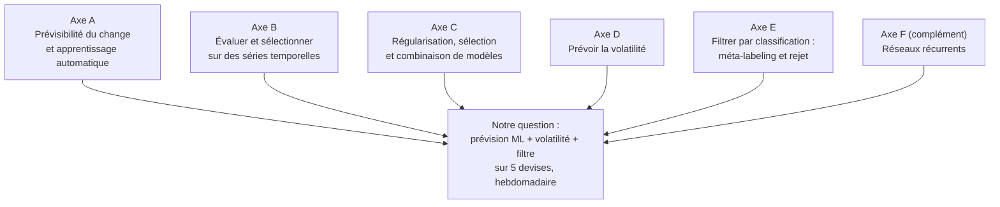

**Axe A — Prévisibilité du change et apprentissage automatique.** Depuis Meese et Rogoff (1983), la marche
aléatoire est la référence à battre, et Rossi (2013) montre que les succès dépendent fortement du
prédicteur, de l'horizon et de la période. Les travaux récents en ML sont plus encourageants : Amat,
Michalski et Stoltz (2018) battent la marche aléatoire à un mois avec une Ridge séquentielle sur des
fondamentaux, et Filippou, Rapach, Taylor et Zhou (CEPR DP15305) améliorent la prévision mensuelle avec
l'Elastic net et des réseaux profonds, en notant peu de non-linéarité. À l'inverse, Kılıç (2025) trouve
que les modèles très complexes à caractéristiques aléatoires ne battent pas de façon fiable la marche
aléatoire sur huit paires contre l'USD. Les écarts de taux et le momentum sont des signaux documentés
(Lustig, Roussanov et Verdelhan, 2011 ; Menkhoff et al., 2012). Sur les actions, Gu, Kelly et Xiu (2020)
servent de référence pour comparer de nombreux modèles ML dans un même protocole.
*Ce que nous en retenons :* à l'horizon **hebdomadaire**, des $R^2_{OS}$ proches de zéro sont attendus ;
la question intéressante est de savoir si un signal faible, combiné à la volatilité et à un filtre, reste
exploitable.

**Axe B — Évaluer et sélectionner sur des séries temporelles.** Le cours pose le principe de base :
entraînement, validation et test séparés (Goodfellow et al., 2016, §5.3 ; ESL ch. 7). Pour des données
dépendantes, la validation croisée classique est discutée : on propose des plis par blocs avec zone
tampon (Racine, 2000 ; Bergmeir et Benítez, 2012), alors que Bergmeir, Hyndman et Koo (2018) la jugent
valide pour certains modèles autorégressifs, et que Cerqueira, Torgo et Mozetič (2020) recommandent de
respecter l'ordre du temps pour les séries non stationnaires. L'évaluation à origine glissante est la
référence hors échantillon (Tashman, 2000). Enfin, sélectionner un modèle sur un échantillon fini
sur-ajuste la sélection elle-même (Cawley et Talbot, 2010), et toute information indisponible au moment
de prévoir est une fuite (Kaufman et al., 2012).
*Ce que nous en retenons :* walk-forward strict, test regardé une fois, comparaison explicite des schémas
de validation croisée.

**Axe C — Régularisation, sélection et combinaison de modèles.** La Ridge (Hoerl et Kennard, 1970), le
Lasso (Tibshirani, 1996) et l'Elastic net (Zou et Hastie, 2005) réduisent la variance en acceptant un peu
de biais (ESL §3.4 ; diapos *ml-fundamentals* sur la régularisation et le compromis biais-variance). La
forêt aléatoire (Breiman, 2001) réduit la variance en moyennant des arbres décorrélés (ESL ch. 15), et
ses hyperparamètres méritent d'être réglés (Probst, Wright et Boulesteix, 2019). Pour combiner des
modèles, le stacking (Wolpert, 1992 ; Breiman, 1996 ; ESL §8.8) apprend des poids, mais la moyenne simple
est souvent aussi bonne (Bates et Granger, 1969 ; Timmermann, 2006 ; Smith et Wallis, 2009), parce que
l'estimation des poids ajoute de l'erreur (Claeskens et al., 2016). Pour la prévision de la prime de
risque des actions, Rapach, Strauss et Zhou (2010) montrent aussi que combiner des prévisions donne des
résultats plus stables que chaque modèle seul.
*Ce que nous en retenons :* MIXT, qui choisit un seul modèle par devise, doit être comparé à la moyenne et
au stacking.

**Axe D — Prévoir la volatilité.** La volatilité est persistante (Bollerslev, 1986) et la volatilité
réalisée en est une mesure observable (Andersen, Bollerslev, Diebold et Labys, 2003). Le HAR (Corsi,
2009) est la référence simple ; le GARCH(1,1) est très difficile à battre sur le change (Hansen et Lunde,
2005) ; des méthodes d'apprentissage peuvent faire mieux avec des prédicteurs supplémentaires
(Christensen, Siggaard et Veliyev, 2023). Les comparaisons doivent utiliser une perte robuste comme QLIKE
(Patton, 2011). Diviser une exposition par la volatilité prévue améliore le Sharpe (Moreira et Muir,
2017).
*Ce que nous en retenons :* GARCH contre HAR, jugés avec QLIKE, puis ablation du signal avec et sans
volatilité.

**Axe E — Filtrer par classification : méta-labeling et rejet.** Le méta-labeling (López de Prado,
2018 ; Joubert, 2022 ; Meyer, Barziy et Joubert, 2023) correspond, en ML, à la classification avec option
de rejet (Chow, 1970 ; Herbei et Wegkamp, 2006 ; El-Yaniv et Wiener, 2010 ; Geifman et El-Yaniv, 2017),
déjà appliquée à des stratégies de trading qui s'abstiennent de prendre position (Chalkidis et Savani,
2021). La
qualité des probabilités se mesure par le score de Brier (Brier, 1950) et la calibration (Niculescu-Mizil
et Caruana, 2005), la capacité à classer par l'AUC (Fawcett, 2006), et la présence d'un vrai signal par un
test de permutation (Ojala et Garriga, 2010).
*Ce que nous en retenons :* le filtre est jugé comme un classifieur sélectif (courbe risque-couverture) et
contre des placebos, pas seulement par le Sharpe final.

**Axe F (complément) — Réseaux récurrents.** Le LSTM (Hochreiter et Schmidhuber, 1997) a donné de bons
résultats sur les actions (Fischer et Krauss, 2018), mais les études larges le jugent compétitif sans être
supérieur (Hewamalage, Bergmeir et Bandara, 2021 ; Makridakis, Spiliotis et Assimakopoulos, 2018), et les
arbres dominent souvent sur des données tabulaires (Grinsztajn, Oyallon et Varoquaux, 2022). La
variabilité due aux graines doit être rapportée (Bouthillier et al., 2021).

**Où se situe notre contribution.**
- La plupart des travaux ML sur le change sont **mensuels** (Amat et al., 2018 ; Filippou et al.) ; nous
  travaillons à l'horizon **hebdomadaire**, avec un ensemble de données construit pour l'étude.
- Les travaux sur le méta-labeling viennent surtout de praticiens (López de Prado, 2018 ; Joubert,
  2022 ; Meyer et al., 2023) et évaluent le filtre par la performance de la stratégie. La classification
  sélective a déjà été appliquée au trading, avec un classifieur qui s'abstient de prendre position
  (Chalkidis et Savani, 2021). En revanche, nos recherches (24 novembre 2026) n'ont pas trouvé d'étude
  publiée qui évalue un méta-classifieur **contre des filtres au hasard gardant le même nombre de
  trades** et **contre la confiance du modèle primaire**, comme nous le faisons. Dans le rapport, on le
  formulera prudemment : « à notre connaissance ».
- Notre étude d'ablation mesure séparément la contribution de chaque bloc ML, plutôt que de rapporter
  seulement la performance de la chaîne complète.

**Pistes pour la section « travaux futurs ».**
- Entraîner directement le modèle pour la décision de classement plutôt que pour l'erreur quadratique :
  apprentissage guidé par la décision (Elmachtoub et Grigas, 2022) et *learning to rank* appliqué au
  change (Poh, Lim, Zohren et Roberts, arXiv:2105.10019).
- Le débat sur la « vertu de la complexité » (Kelly, Malamud et Zhou, 2024 ; Nagel, 2025 ; Kılıç, 2025).

---

## 10. Ressources du cours à citer

| Notion utilisée | Ressource du cours |
|---|---|
| Sous-ajustement, sur-ajustement, régularisation, biais-variance | Diapos *ml-fundamentals*, p. 47–50, 59–62, 69–79 ; Goodfellow et al. (2016), §5.2 et §5.4 ; ESL §2.9 et §7.2–7.3 |
| Ensemble de validation, hyperparamètres, validation croisée | Diapos *ml-fundamentals*, p. 63–67 ; Goodfellow et al. (2016), §5.3 et §5.3.1 ; ESL §7.10 |
| Pas-à-pas, Ridge, Lasso, régression sur composantes principales | ESL §3.3, §3.4 et §3.5.1 |
| Régression logistique | ESL §4.4 ; diapos *supervised*, p. 74 (pour deux classes, la probabilité a posteriori de l'analyse discriminante linéaire a la forme logistique) ; diapos *nn*, p. 60 (unité de sortie sigmoïde pour une cible binaire) |
| Bootstrap | ESL §7.11 et §8.2 |
| Bagging, moyenne de modèles, stacking | ESL §8.7 et §8.8 |
| Forêt aléatoire et importance des variables | ESL ch. 15 (§15.3.2 pour l'importance) |
| Tests multiples | ESL §18.7 |
| Réseaux de neurones, arrêt précoce | Goodfellow et al. (2016), ch. 6 ; diapos *nn*, p. 61 ; ESL ch. 11 |
| LSTM et gradient qui s'évanouit | Diapos *rnn-cnn*, p. 38 |

*Les numéros de pages des diapos ont été vérifiés en extrayant le texte de chaque page citée dans les
PDF du cours.*

---

## 11. Bibliographie

**Statut de vérification** (24 novembre 2026) :
- **Crossref** : titre, auteurs, revue, volume, numéro, pages et DOI comparés aux métadonnées officielles
  de Crossref ;
- **en ligne** : notice vérifiée sur le site de la revue, de la conférence ou d'un dépôt reconnu (JMLR,
  NeurIPS, arXiv, NBER, CEPR, RePEc), pour les publications sans DOI Crossref ;
- **manuel** : ouvrage de référence (éditeur et année connus).

Dans le texte, « ESL » désigne Hastie, Tibshirani et Friedman (2009).

### Axe A — Change et apprentissage automatique
| Référence | Statut |
|---|---|
| Amat, C., Michalski, T. et Stoltz, G. (2018). Fundamentals and exchange rate forecastability with simple machine learning methods. *Journal of International Money and Finance*, 88, 1–24. doi:10.1016/j.jimonfin.2018.06.003 | en ligne |
| Campbell, J. Y. et Thompson, S. B. (2008). Predicting excess stock returns out of sample: Can anything beat the historical average? *Review of Financial Studies*, 21(4), 1509–1531. doi:10.1093/rfs/hhm055 | Crossref |
| Filippou, I., Rapach, D., Taylor, M. et Zhou, G. Exchange rate prediction with machine learning and a smart carry trade portfolio. CEPR Discussion Paper DP15305. | en ligne (document de travail) |
| Gu, S., Kelly, B. et Xiu, D. (2020). Empirical asset pricing via machine learning. *Review of Financial Studies*, 33(5), 2223–2273. doi:10.1093/rfs/hhaa009 | Crossref |
| Kılıç, R. (2025). Virtue or mirage? Complexity in exchange rate prediction. Federal Reserve, FEDS 2025-089. | en ligne |
| Lustig, H., Roussanov, N. et Verdelhan, A. (2011). Common risk factors in currency markets. *Review of Financial Studies*, 24(11), 3731–3777. doi:10.1093/rfs/hhr068 | Crossref |
| Meese, R. A. et Rogoff, K. (1983). Empirical exchange rate models of the seventies: Do they fit out of sample? *Journal of International Economics*, 14(1–2), 3–24. doi:10.1016/0022-1996(83)90017-X | Crossref |
| Menkhoff, L., Sarno, L., Schmeling, M. et Schrimpf, A. (2012). Currency momentum strategies. *Journal of Financial Economics*, 106(3), 660–684. doi:10.1016/j.jfineco.2012.06.009 | Crossref |
| Rossi, B. (2013). Exchange rate predictability. *Journal of Economic Literature*, 51(4), 1063–1119. doi:10.1257/jel.51.4.1063 | Crossref |
| Welch, I. et Goyal, A. (2008). A comprehensive look at the empirical performance of equity premium prediction. *Review of Financial Studies*, 21(4), 1455–1508. doi:10.1093/rfs/hhm014 | Crossref |

### Axe B — Évaluation, validation croisée, fuite et reproductibilité
| Référence | Statut |
|---|---|
| Arlot, S. et Celisse, A. (2010). A survey of cross-validation procedures for model selection. *Statistics Surveys*, 4, 40–79. doi:10.1214/09-SS054 | Crossref |
| Bergmeir, C. et Benítez, J. M. (2012). On the use of cross-validation for time series predictor evaluation. *Information Sciences*, 191, 192–213. doi:10.1016/j.ins.2011.12.028 | Crossref |
| Bergmeir, C., Hyndman, R. J. et Koo, B. (2018). A note on the validity of cross-validation for evaluating autoregressive time series prediction. *Computational Statistics & Data Analysis*, 120, 70–83. doi:10.1016/j.csda.2017.11.003 | en ligne |
| Cawley, G. C. et Talbot, N. L. C. (2010). On over-fitting in model selection and subsequent selection bias in performance evaluation. *Journal of Machine Learning Research*, 11, 2079–2107. | en ligne |
| Cerqueira, V., Torgo, L. et Mozetič, I. (2020). Evaluating time series forecasting models: An empirical study on performance estimation methods. *Machine Learning*, 109(11), 1997–2028. doi:10.1007/s10994-020-05910-7 | en ligne |
| Kaufman, S., Rosset, S., Perlich, C. et Stitelman, O. (2012). Leakage in data mining: Formulation, detection, and avoidance. *ACM Transactions on Knowledge Discovery from Data*, 6(4), article 15. doi:10.1145/2382577.2382579 | en ligne |
| Pineau, J. et al. (2021). Improving reproducibility in machine learning research (A report from the NeurIPS 2019 reproducibility program). *Journal of Machine Learning Research*, 22(164), 1–20. | en ligne |
| Racine, J. (2000). Consistent cross-validatory model-selection for dependent data: hv-block cross-validation. *Journal of Econometrics*, 99(1), 39–61. doi:10.1016/S0304-4076(00)00030-0 | en ligne |
| Tashman, L. J. (2000). Out-of-sample tests of forecasting accuracy: An analysis and review. *International Journal of Forecasting*, 16(4), 437–450. doi:10.1016/S0169-2070(00)00065-0 | Crossref |

### Axe C — Régularisation, arbres, sélection et combinaison
| Référence | Statut |
|---|---|
| Bates, J. M. et Granger, C. W. J. (1969). The combination of forecasts. *Operational Research Quarterly*, 20(4), 451–468. doi:10.2307/3008764 | Crossref |
| Breiman, L. (1996). Stacked regressions. *Machine Learning*, 24(1), 49–64. doi:10.1023/A:1018046112532 | Crossref |
| Breiman, L. (2001). Random forests. *Machine Learning*, 45(1), 5–32. doi:10.1023/A:1010933404324 | Crossref |
| Claeskens, G., Magnus, J. R., Vasnev, A. L. et Wang, W. (2016). The forecast combination puzzle: A simple theoretical explanation. *International Journal of Forecasting*, 32(3), 754–762. doi:10.1016/j.ijforecast.2015.12.005 | en ligne |
| Hoerl, A. E. et Kennard, R. W. (1970). Ridge regression: Biased estimation for nonorthogonal problems. *Technometrics*, 12(1), 55–67. doi:10.1080/00401706.1970.10488634 | Crossref |
| Probst, P., Wright, M. N. et Boulesteix, A.-L. (2019). Hyperparameters and tuning strategies for random forest. *WIREs Data Mining and Knowledge Discovery*, 9(3), e1301. doi:10.1002/widm.1301 | en ligne |
| Rapach, D. E., Strauss, J. K. et Zhou, G. (2010). Out-of-sample equity premium prediction: Combination forecasts and links to the real economy. *Review of Financial Studies*, 23(2), 821–862. doi:10.1093/rfs/hhp063 | Crossref |
| Smith, J. et Wallis, K. F. (2009). A simple explanation of the forecast combination puzzle. *Oxford Bulletin of Economics and Statistics*, 71(3), 331–355. doi:10.1111/j.1468-0084.2008.00541.x | Crossref |
| Strobl, C., Boulesteix, A.-L., Zeileis, A. et Hothorn, T. (2007). Bias in random forest variable importance measures: Illustrations, sources and a solution. *BMC Bioinformatics*, 8, 25. doi:10.1186/1471-2105-8-25 | Crossref |
| Tibshirani, R. (1996). Regression shrinkage and selection via the lasso. *Journal of the Royal Statistical Society, Series B*, 58(1), 267–288. doi:10.1111/j.2517-6161.1996.tb02080.x | Crossref |
| Timmermann, A. (2006). Forecast combinations. Dans G. Elliott, C. W. J. Granger et A. Timmermann (dir.), *Handbook of Economic Forecasting*, vol. 1, ch. 4, 135–196. Elsevier. | en ligne |
| Wolpert, D. H. (1992). Stacked generalization. *Neural Networks*, 5(2), 241–259. doi:10.1016/S0893-6080(05)80023-1 | Crossref |
| Zou, H. et Hastie, T. (2005). Regularization and variable selection via the elastic net. *Journal of the Royal Statistical Society, Series B*, 67(2), 301–320. doi:10.1111/j.1467-9868.2005.00503.x | Crossref |

### Axe D — Volatilité
| Référence | Statut |
|---|---|
| Andersen, T. G., Bollerslev, T., Diebold, F. X. et Labys, P. (2003). Modeling and forecasting realized volatility. *Econometrica*, 71(2), 579–625. doi:10.1111/1468-0262.00418 | en ligne |
| Bollerslev, T. (1986). Generalized autoregressive conditional heteroskedasticity. *Journal of Econometrics*, 31(3), 307–327. doi:10.1016/0304-4076(86)90063-1 | Crossref |
| Christensen, K., Siggaard, M. et Veliyev, B. (2023). A machine learning approach to volatility forecasting. *Journal of Financial Econometrics*, 21(5), 1680–1727. doi:10.1093/jjfinec/nbac032 | en ligne |
| Corsi, F. (2009). A simple approximate long-memory model of realized volatility. *Journal of Financial Econometrics*, 7(2), 174–196. doi:10.1093/jjfinec/nbp001 | Crossref |
| Hansen, P. R. et Lunde, A. (2005). A forecast comparison of volatility models: Does anything beat a GARCH(1,1)? *Journal of Applied Econometrics*, 20(7), 873–889. doi:10.1002/jae.800 | en ligne |
| Moreira, A. et Muir, T. (2017). Volatility-managed portfolios. *Journal of Finance*, 72(4), 1611–1644. doi:10.1111/jofi.12513 | Crossref |
| Patton, A. J. (2011). Volatility forecast comparison using imperfect volatility proxies. *Journal of Econometrics*, 160(1), 246–256. doi:10.1016/j.jeconom.2010.03.034 | Crossref |

### Axe E — Méta-labeling, rejet, calibration
| Référence | Statut |
|---|---|
| Brier, G. W. (1950). Verification of forecasts expressed in terms of probability. *Monthly Weather Review*, 78(1), 1–3. doi:10.1175/1520-0493(1950)078<0001:VOFEIT>2.0.CO;2 | Crossref |
| Chalkidis, N. et Savani, R. (2021). Trading via selective classification. *Proceedings of the Second ACM International Conference on AI in Finance (ICAIF '21)*. arXiv:2110.14914 | en ligne |
| Chow, C. K. (1970). On optimum recognition error and reject tradeoff. *IEEE Transactions on Information Theory*, 16(1), 41–46. doi:10.1109/TIT.1970.1054406 | Crossref |
| El-Yaniv, R. et Wiener, Y. (2010). On the foundations of noise-free selective classification. *Journal of Machine Learning Research*, 11, 1605–1641. | en ligne |
| Fawcett, T. (2006). An introduction to ROC analysis. *Pattern Recognition Letters*, 27(8), 861–874. doi:10.1016/j.patrec.2005.10.010 | Crossref |
| Geifman, Y. et El-Yaniv, R. (2017). Selective classification for deep neural networks. *Advances in Neural Information Processing Systems 30*. arXiv:1705.08500 | en ligne |
| Herbei, R. et Wegkamp, M. H. (2006). Classification with reject option. *Canadian Journal of Statistics*, 34(4), 709–721. doi:10.1002/cjs.5550340410 | en ligne |
| Joubert, J. F. (2022). Meta-labeling: Theory and framework. *Journal of Financial Data Science*, 4(3), 31–44. doi:10.3905/jfds.2022.1.098 | Crossref |
| López de Prado, M. (2018). *Advances in Financial Machine Learning*. Wiley. | manuel |
| Meyer, M., Barziy, I. et Joubert, J. F. (2023). Meta-labeling: Calibration and position sizing. *Journal of Financial Data Science*, 5(2), 23–40. doi:10.3905/jfds.2023.1.119 | Crossref |
| Niculescu-Mizil, A. et Caruana, R. (2005). Predicting good probabilities with supervised learning. *Proceedings of the 22nd International Conference on Machine Learning (ICML)*, 625–632. doi:10.1145/1102351.1102430 | Crossref |
| Ojala, M. et Garriga, G. C. (2010). Permutation tests for studying classifier performance. *Journal of Machine Learning Research*, 11, 1833–1863. | en ligne |

### Axe F — Réseaux de neurones et variabilité
| Référence | Statut |
|---|---|
| Bouthillier, X. et al. (2021). Accounting for variance in machine learning benchmarks. *Proceedings of Machine Learning and Systems*, 3. arXiv:2103.03098 | en ligne |
| Caruana, R. (1997). Multitask learning. *Machine Learning*, 28(1), 41–75. doi:10.1023/A:1007379606734 | Crossref |
| Fischer, T. et Krauss, C. (2018). Deep learning with long short-term memory networks for financial market predictions. *European Journal of Operational Research*, 270(2), 654–669. doi:10.1016/j.ejor.2017.11.054 | Crossref |
| Grinsztajn, L., Oyallon, E. et Varoquaux, G. (2022). Why do tree-based models still outperform deep learning on typical tabular data? *NeurIPS 2022, Datasets and Benchmarks Track*. arXiv:2207.08815 | en ligne |
| Hewamalage, H., Bergmeir, C. et Bandara, K. (2021). Recurrent neural networks for time series forecasting: Current status and future directions. *International Journal of Forecasting*, 37(1), 388–427. doi:10.1016/j.ijforecast.2020.06.008 | en ligne |
| Hochreiter, S. et Schmidhuber, J. (1997). Long short-term memory. *Neural Computation*, 9(8), 1735–1780. doi:10.1162/neco.1997.9.8.1735 | Crossref |
| Lakshminarayanan, B., Pritzel, A. et Blundell, C. (2017). Simple and scalable predictive uncertainty estimation using deep ensembles. *Advances in Neural Information Processing Systems 30*, 6402–6413. | en ligne |
| Makridakis, S., Spiliotis, E. et Assimakopoulos, V. (2018). Statistical and machine learning forecasting methods: Concerns and ways forward. *PLOS ONE*, 13(3), e0194889. doi:10.1371/journal.pone.0194889 | Crossref |

### Inférence et tests statistiques
| Référence | Statut |
|---|---|
| Bailey, D. H. et López de Prado, M. (2014). The deflated Sharpe ratio: Correcting for selection bias, backtest overfitting, and non-normality. *Journal of Portfolio Management*, 40(5), 94–107. doi:10.3905/jpm.2014.40.5.094 | en ligne |
| Clark, T. E. et West, K. D. (2007). Approximately normal tests for equal predictive accuracy in nested models. *Journal of Econometrics*, 138(1), 291–311. doi:10.1016/j.jeconom.2006.05.023 | Crossref |
| Diebold, F. X. et Mariano, R. S. (1995). Comparing predictive accuracy. *Journal of Business & Economic Statistics*, 13(3), 253–263. doi:10.1080/07350015.1995.10524599 | Crossref |
| Hansen, P. R., Lunde, A. et Nason, J. M. (2011). The model confidence set. *Econometrica*, 79(2), 453–497. doi:10.3982/ECTA5771 | Crossref |
| Harvey, D., Leybourne, S. et Newbold, P. (1997). Testing the equality of prediction mean squared errors. *International Journal of Forecasting*, 13(2), 281–291. doi:10.1016/S0169-2070(96)00719-4 | Crossref |
| Holm, S. (1979). A simple sequentially rejective multiple test procedure. *Scandinavian Journal of Statistics*, 6(2), 65–70. (JSTOR 4615733) | en ligne |
| Künsch, H. R. (1989). The jackknife and the bootstrap for general stationary observations. *Annals of Statistics*, 17(3), 1217–1241. doi:10.1214/aos/1176347265 | Crossref |
| Newey, W. K. et West, K. D. (1987). A simple, positive semi-definite, heteroskedasticity and autocorrelation consistent covariance matrix. *Econometrica*, 55(3), 703–708. doi:10.2307/1913610 | Crossref |
| Newey, W. K. et West, K. D. (1994). Automatic lag selection in covariance matrix estimation. *Review of Economic Studies*, 61(4), 631–653. doi:10.2307/2297912 | Crossref |
| Politis, D. N. et Romano, J. P. (1994). The stationary bootstrap. *Journal of the American Statistical Association*, 89(428), 1303–1313. doi:10.1080/01621459.1994.10476870 | Crossref |

### Manuels du cours
| Référence | Statut |
|---|---|
| Goodfellow, I., Bengio, Y. et Courville, A. (2016). *Deep Learning*. MIT Press (ch. 5 et 6 fournis dans le cours). | manuel |
| Hastie, T., Tibshirani, R. et Friedman, J. (2009). *The Elements of Statistical Learning* (2e éd.). Springer. Sections citées vérifiées dans la table des matières du PDF du cours. | manuel |

### Travaux futurs et contexte (cités seulement en perspective)
| Référence | Statut |
|---|---|
| Elmachtoub, A. N. et Grigas, P. (2022). Smart "predict, then optimize". *Management Science*, 68(1), 9–26. doi:10.1287/mnsc.2020.3922 | en ligne |
| Kelly, B., Malamud, S. et Zhou, K. (2024). The virtue of complexity in return prediction. *Journal of Finance*, 79(1), 459–503. doi:10.1111/jofi.13298 | en ligne |
| Nagel, S. (2025). Seemingly virtuous complexity in return prediction. NBER Working Paper 34104. | en ligne |
| Poh, D., Lim, B., Zohren, S. et Roberts, S. Enhancing cross-sectional currency strategies by context-aware learning to rank with self-attention. arXiv:2105.10019. | en ligne |

## 12. Liste de contrôle pour le rapport

- ☐ Chaque figure a des axes étiquetés avec leurs unités, une légende et une légende de figure complète.
- ☐ Chaque symbole d'une équation est défini à sa première apparition.
- ☐ Aucun choix n'est fait sur le test, et le registre (section 8) est complet.
- ☐ Tous les résultats sont rapportés, y compris les mauvais.
- ☐ Les comparaisons sont équitables : mêmes données, mêmes fréquences de ré-estimation, réglages faits
  sur la validation.
- ☐ Robustesse : sous-périodes et sensibilité aux choix *a priori* (τ, 60 % d'entraînement initial).
- ☐ Les chiffres du texte correspondent aux CSV.
- ☐ Chaque choix méthodologique important cite sa source (section 3).
- ☐ La section « travaux reliés » synthétise les axes de la section 9 et positionne notre contribution.
- ☐ La discussion compare chaque résultat principal à la littérature (étapes 1 à 5).
- ☐ Toutes les références « classique » ont leurs pages confirmées ; style de citation uniforme.
