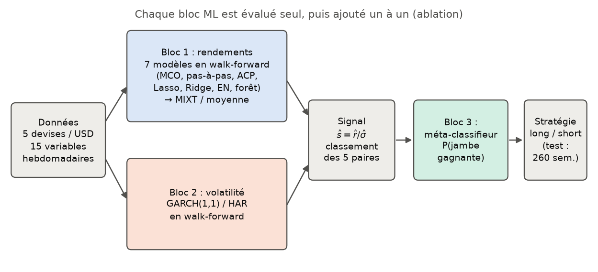
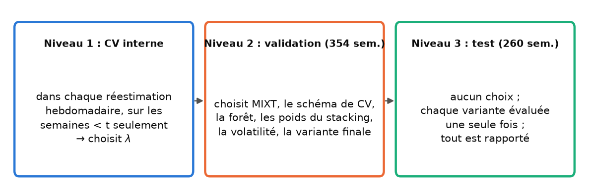

# Synthèse des résultats — pour Ulrich et Rami

Ce document résume, en quelques pages, ce qui a été fait et trouvé avant la rédaction du rapport en
équipe. **Ce n'est pas le rapport :** il sert à ce qu'on se mette d'accord sur les résultats et sur les
décisions à prendre ensemble. Le détail complet (choix, protocole, résultats, littérature, références
vérifiées) est dans [`docs/JOURNAL_PROJET.md`](JOURNAL_PROJET.md). Les figures (PDF) et les tableaux
(LaTeX) prêts pour Overleaf sont dans [`docs/paquet_equipe/`](paquet_equipe/).

---

## 1. Question et approche

**Question validée par le prof :** des modèles d'apprentissage automatique, combinés à une prévision de
volatilité et à un filtre de classification, peuvent-ils produire un signal ajusté au risque assez
fiable pour bâtir une stratégie long/short hebdomadaire rentable sur cinq grandes devises ?

**Approche : une étude d'ablation.** La question contient trois blocs ML. On évalue chacun seul, avec des
métriques ML, puis on les ajoute un à un à la stratégie pour mesurer ce que chacun apporte. Conformément
aux consignes du prof, la finance ne sert que d'évaluation finale.

## 2. Protocole

Trois règles, appliquées à toutes les expériences :
1. tous les choix (modèle, réglage, seuil, poids) se font **sur la validation seulement** ;
2. chaque variante est évaluée **une seule fois** sur le test ;
3. **tous les résultats sont rapportés**, même mauvais.

Les données de l'ancien projet sont figées, les versions des paquets aussi (`requirements-lock.txt`), et
le pipeline se reproduit exactement, sauf une petite différence de la forêt aléatoire due à la machine
(journal, étape 0).

## 3. Résultats clés

**Bloc 1 — Prévoir les rendements.**
- Après correction de Holm pour 40 tests, **aucun modèle ne bat la moyenne historique** sur le test
  (11 tests significatifs à 10 % sans correction, 0 avec) — tableau 1, figure 4.
- Choisir un modèle par devise (MIXT) est **instable** : rééchantillonner la validation ne fait rechoisir
  le même modèle que 35 % à 80 % du temps (figure 9). Sur le test, la **moyenne simple** des 7 modèles
  fait mieux que MIXT ($R^2_{OS}$ de −0,32 % contre −1,80 %) — tableau 3, figure 7.
- **Régler la forêt** sur la validation fait passer son $R^2_{OS}$ de test de −5,23 % à −0,15 % (figure 6).
- La validation croisée par plis aléatoires est gardée selon la règle ; c'est pourtant le
  *forward-chaining* qui fait le mieux sur le test (tableau 2, figure 5).
- Les variables qui comptent un peu sont le rendement de la semaine passée et la volatilité sur
  4 semaines ; les modèles ne s'accordent pas d'une devise à l'autre (figures 10 et 11).

**Bloc 2 — Prévoir la volatilité.**
- Le **HAR** prévoit un peu mieux que le GARCH (QLIKE 0,401 contre 0,415 sur le test), sans écart
  significatif après Holm ; les deux battent nettement les références naïves — tableau 4, figure 12.
- **Diviser la prévision de rendement par la volatilité n'améliore pas le classement des devises**
  (figure 14).

**Bloc 3 — Le méta-classifieur** (l'élément central de la nouveauté).
- Il sépare à peine les bonnes jambes des mauvaises : AUC de 0,53 (achats) et 0,55 (ventes) ;
  permutation des étiquettes $p$ = 0,14 et 0,06 — tableau 5, figures 15 et 17.
- **Placebo :** 12 % des filtres au hasard qui gardent le même nombre de jambes font au moins aussi bien
  que lui ($p$ = 0,118) — figure 16.
- La **force du signal du premier modèle** ($|\hat s|$) classe les jambes aussi bien que lui — tableau 6,
  figure 18.

**Ablation de bout en bout** (tableau 7, figures 19 et 20).

| | Naïf | + prévision ML | + volatilité | + méta-classifieur |
|---|---|---|---|---|
| Chaîne d'origine (Sharpe, test) | 0,15 | 0,54 | 0,45 | **0,88** |
| Chaîne mise à jour, exploratoire | 0,15 | 0,57 | 0,52 | 0,74 |

- Le Sharpe de 0,88 est le seul dont l'intervalle de confiance à 95 % exclut zéro ([0,09 ; 1,83]), mais
  il ne résiste ni au placebo ($p$ = 0,117), ni à la correction pour les 29 stratégies essayées dans le
  projet (Deflated Sharpe de 0,77, sous le seuil de 0,95).
- **Effet mécanique découvert :** le filtre garde surtout des semaines avec la vente seule, qui encaissent
  le taux de financement (DFF). Sans ce financement, le Sharpe tombe de 0,88 à 0,73 ; dans la chaîne mise
  à jour, le gain du filtre disparaît entièrement.

**Complément LSTM** (tableau 8, figure 21) : un LSTM à 5 sorties, réglé sur la validation et moyenné sur
5 graines, ne classe pas mieux les devises qu'une Ridge réestimée aux mêmes dates. Son léger gain de
précision vient de la moyenne des graines.

## 4. Réponse à la question

Sur cinq devises à l'horizon hebdomadaire, la combinaison proposée **ne produit pas un signal dont on
puisse établir statistiquement la fiabilité**. La performance observée (Sharpe de 0,88) est compatible
avec la chance une fois contrôlés le nombre d'essais, la sélection des jambes et le financement. C'est
un résultat négatif, mais démontré avec rigueur, et le barème note la qualité de la démonstration, pas
la performance.

## 5. Limites à discuter dans le rapport

- **Puissance statistique faible :** 260 semaines de test donnent un intervalle de confiance d'environ
  ±0,9 sur un Sharpe annualisé.
- **Une seule période de test** (2021–2026), marquée par la hausse des taux ; aucune autre période
  hors échantillon n'est disponible.
- **Coûts de transaction et portage (*carry*) ignorés**, comme dans l'ancien projet.
- **Résultats de test déjà vus** avant ces expériences (ancien projet) : c'est pourquoi la chaîne
  d'origine reste la réponse principale, et la chaîne mise à jour est présentée comme exploratoire.
- **Méta-classifieur entraîné sur des jambes de validation optimistes** (MIXT choisi sur ces mêmes
  semaines) — point P2 du journal.
- **Courbes risque-couverture :** diagnostic qui classe toutes les jambes de test à la fois, pas une
  règle utilisable en temps réel.
- **Reproductibilité de la forêt d'une machine à l'autre** : petites différences pour CAD et CHF.

## 6. Pistes pour les travaux futurs

- Entraîner le modèle directement pour la décision de classement plutôt que pour l'erreur quadratique
  (apprentissage guidé par la décision, *learning to rank* sur le change).
- Plus de devises et plus de prédicteurs, ou un horizon mensuel, où la littérature trouve plus de
  prévisibilité.
- Le débat sur la « vertu de la complexité » appliqué au change.
- Intégrer les coûts de transaction et le portage dans l'évaluation.

## 7. Décisions à prendre en équipe

1. **Style de citation** du rapport : auteur-année (comme dans le journal) ou numérique.
2. **Partie financière :** la raccourcir (Moreira et Muir, Menkhoff et al.) pour laisser la place au ML,
   comme le demande le prof ?
3. **Répartition des 13 pages :** quelles figures dans le texte, lesquelles en annexe (21 figures et
   8 tableaux sont disponibles).
4. **Langue et ton du rapport** (français, comme le plan d'étude ?).

**Point P3, résolu :** la règle de la stratégie « corrigée » (ne rien faire quand tous les Sharpe prévus
sont positifs) était déjà dans l'ancien projet et a été décidée avant de voir le test. C'est une variante
légitime, comptée parmi les 29 essais du Deflated Sharpe.

Les DOI de Joubert (2022) et de Meyer et al. (2023) sont maintenant confirmés (journal, section 11).

## 8. Contenu du paquet

| Fichier | Contenu |
|---|---|
| `paquet_equipe/figures/fig01` à `fig21` (PDF) | Figures numérotées dans l'ordre logique : découpage, pipeline, protocole, puis blocs 1, 2, 3, ablation et LSTM |
| `paquet_equipe/figures/fig02`, `fig03` (PNG aussi) | Schémas du pipeline et du protocole |
| `paquet_equipe/tableaux/tab01` à `tab08` (`.tex` + `.csv`) | Tableaux principaux, générés automatiquement à partir des résultats ; à inclure avec `\input{}`, nécessitent `\usepackage{booktabs}` |
| `Code/experiments/` | Un script par expérience, plus `e7_paquet_equipe.py` qui régénère ce paquet |
| `experiments/` | Résultats complets de chaque expérience (CSV, figures, environnement) |

Tout se régénère avec les commandes de l'étape 0 du journal, puis les scripts de `Code/experiments/`.
